# CI/CD: выполненные задания за 2026 год

> **Дата выполнения:** 26.10.2026

В отчёте собраны выполненные CI-проекты и начатая серия CI/CD по [заданиям преподавателя](../../../content/DevOps/CI_CD/README.md). Снимки страниц репозиториев показывают структуру файлов и статус коммита, а снимки терминалов — результаты локальных проверок. В оглавлении преподавателя перечислено 8 заданий в разделе CI/CD и ещё 2 задания в отдельном разделе CI/CD (Deploy). В отчёте оформлены первые четыре задания из восьми: Rust и Go с публикацией образов в GHCR, Go с публикацией бинарников в GitHub Releases и Python CLI с PyInstaller.

## Содержание

| № | Проект | Репозиторий | Результат |
|:--:|:--|:--|:--|
| 1 | Python | [my-python-app](https://github.com/karat05/my-python-app-) | GitHub Actions и запуск Docker |
| 2 | Node.js | [my-node-app](https://github.com/karat05/my-node-app-) | GitHub Actions и Docker |
| 3 | Go | [my-go-app](https://github.com/karat05/my-go-app-) | GitHub Actions и Docker |
| 4 | Rust | [my-rust-app](https://github.com/karat05/my-rust-app-) | GitHub Actions и Docker |
| 5 | PHP | [my-php-app](https://github.com/karat05/my-php-app) | GitHub Actions и Docker |
| 6 | C++ | [my-cpp-app](https://github.com/karat05/my-cpp-app) | GitHub Actions и Docker |
| 7 | Java | [hello-java](https://github.com/karat05/hello-java) | GitHub Actions и Docker |
| 8 | Rust, дополнительный проект | [my-rust-app2](https://github.com/karat05/my-rust-app2) | GitHub Actions и Docker |

### Продолжение: задания CI/CD

1. [Rust CLI с публикацией в GHCR — задание 1 из 8](#ci-cd-rust-cli-ghcr)
2. [Go CLI с публикацией в GHCR — задание 2 из 8](#ci-cd-go-cli-ghcr)
3. [Go CLI с публикацией бинарников в GitHub Releases — задание 3 из 8](#ci-cd-go-bin-releases)
4. [Python CLI с PyInstaller и публикацией в GitHub Releases — задание 4 из 8](#ci-cd-python-releases)

---

## 1. Python

**Репозиторий:** [karat05/my-python-app](https://github.com/karat05/my-python-app-)

### Ход выполнения

Подготовлено Python-приложение, тесты и workflow GitHub Actions. После настройки проекта образ `my-python-app:test` был запущен локально командой `docker run --rm my-python-app:test`.

### Скриншоты

Страница GitHub показывает файлы проекта и успешный статус коммита. Второй снимок показывает запуск контейнера и ожидаемое сообщение `Hello from my Python app!`.

## 2. Node.js

**Репозиторий:** [karat05/my-node-app](https://github.com/karat05/my-node-app-)

### Ход выполнения

Добавлены исходный код, тесты, настройки ESLint и workflow для установки зависимостей, линтинга и тестирования. Затем собран Docker-образ `my-node-app:latest` и запущен контейнер.

### Скриншоты

На странице GitHub видны каталог workflow и файлы приложения; зелёная отметка рядом с коммитом подтверждает успешную проверку. В терминале видны завершившаяся сборка и вывод `Hello from Node.js app!`.

## 3. Go

**Репозиторий:** [karat05/my-go-app](https://github.com/karat05/my-go-app-)

### Ход выполнения

Подготовлены Go-модуль, функция сложения, тесты и workflow. Локально собран многоэтапный Docker-образ; запуск контейнера проверен по приветствию и результату вычисления `2 + 3 = 5`.

### Скриншоты

Снимок репозитория показывает исходные файлы, тест и workflow со статусом успешного коммита. Терминал показывает сборку образа и результат работы контейнера.

## 4. Rust

**Репозиторий:** [karat05/my-rust-app](https://github.com/karat05/my-rust-app-)

### Ход выполнения

Созданы проект Cargo, исходный файл и workflow для проверок Rust и сборки Docker-образа. Локально собран образ `my-rust-app:latest` и запущено приложение.

### Скриншоты

Страница GitHub подтверждает наличие Cargo-файлов, Dockerfile и workflow, а также показывает успешный статус коммита. Терминал показывает Docker-сборку и сообщение приложения `Hello from Rust in Docker!`.

## 5. PHP

**Репозиторий:** [karat05/my-php-app](https://github.com/karat05/my-php-app)

### Ход выполнения

Подготовлены исходный код PHP-приложения, Dockerfile и workflow. Образ собран локально и запущен для проверки вывода приложения в контейнере.

### Скриншоты

На странице репозитория видны каталоги исходного кода, тестов и workflow, а также успешный статус коммита. В терминале показаны сборка образа и сообщение `Hello from PHP in Docker!`.

## 6. C++

**Репозиторий:** [karat05/my-cpp-app](https://github.com/karat05/my-cpp-app)

### Ход выполнения

Добавлены исходный код C++, конфигурация CMake, Dockerfile и workflow. Dockerfile собирает приложение внутри контейнера; после сборки контейнер был запущен для проверки результата.

### Скриншоты

Снимок GitHub показывает структуру C++-проекта и успешный статус коммита. Снимок терминала содержит команды сборки и запуска, а также ответ `Hello from C++ in Docker!`.

## 7. Java

**Репозиторий:** [karat05/hello-java](https://github.com/karat05/hello-java)

### Ход выполнения

Созданы Java-проект на Maven, Dockerfile и workflow. Локально собран образ `hello-java:latest`, после чего контейнер запустил JAR-файл приложения.

### Скриншоты

Страница GitHub показывает `pom.xml`, каталог исходного кода, Dockerfile и workflow, а также успешный статус коммита. Терминал показывает этапы сборки и результат запуска: `Hello from Java in Docker!` и версию Java.

## 8. Rust — дополнительный проект

**Репозиторий:** [karat05/my-rust-app2](https://github.com/karat05/my-rust-app2)

### Ход выполнения

Подготовлены второй Rust-проект, Cargo-файлы, Dockerfile и workflow. Локально собран Docker-образ, проверено наличие образа и выполнен запуск приложения.

### Скриншоты

В репозитории видны файлы проекта и успешный статус коммита. Терминал показывает сборку образа, проверку через `docker images` и вывод `Hello from Rust in Docker!` при запуске.

## CI/CD: публикация Rust CLI в GHCR — задание 1 из 8

**Исходное задание:** [CI/CD на Rust CLI с публикацией в GHCR](../../../content/DevOps/CI_CD/Pipelines/CI_CD_Rust.md)

**Репозиторий:** [karat05/hello-rust](https://github.com/karat05/hello-rust)
**Пакет:** `ghcr.io/karat05/hello-rust:latest`

### Цель

В предыдущих заданиях CI проверял код и собирал приложение. В этой работе workflow дополнен публикацией Docker-образа в GitHub Container Registry (GHCR), чтобы готовый образ можно было скачать и запустить отдельно от исходного репозитория.

### Ход выполнения

1. Создан Rust CLI-проект `hello-rust`: библиотека с функциями приветствия и суммы диапазона, исполняемая программа и интеграционные тесты.
2. В Docker-контейнере `rust:1-slim` выполнена команда `cargo test`. Она проверила unit-тесты библиотеки и integration-тесты.
3. Подготовлен многоэтапный Dockerfile: Rust-приложение собирается в builder-образе, а готовый бинарный файл переносится в компактный `debian:stable-slim`. Контейнер запускается от непривилегированного пользователя.
4. Образ `hello-rust` собран и запущен локально. Проверены приветствие, ОС и архитектура контейнера, результат `Sum 1..10 = 55`.
5. В GitHub Actions настроены форматирование (`cargo fmt`), линтинг (`cargo clippy`), тесты (`cargo test`) и release-сборка. При push в `main` workflow входит в GHCR через `GITHUB_TOKEN` и публикует образ с тегами коммита и `latest`.
6. Опубликованный образ скачан командой `docker pull ghcr.io/karat05/hello-rust:latest` и запущен локально для проверки.

### Результат и скриншоты

**Проверка тестов.** Видно, что прошли два unit-теста и два integration-теста; ошибок нет.

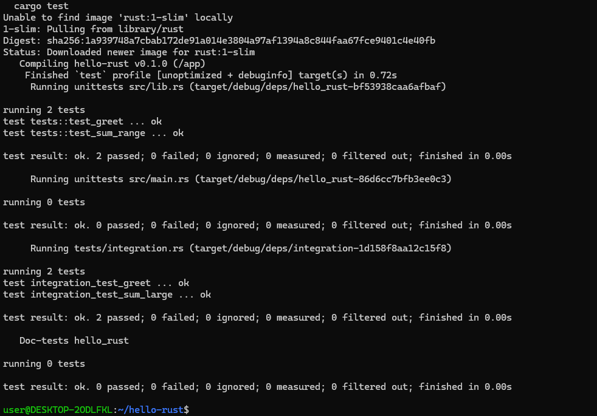

**Локальная Docker-сборка.** Терминал показывает успешное завершение сборки образа и запуск `hello-rust`. Программа вывела приветствие, `OS: linux`, `Arch: x86_64` и сумму диапазона.

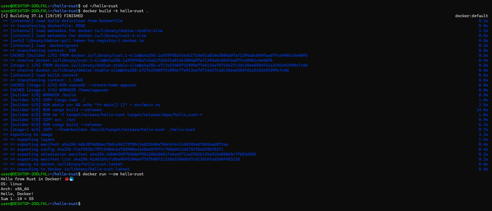

**Репозиторий и публикация.** На странице `hello-rust` виден зелёный статус коммита и опубликованный пакет в блоке Packages.

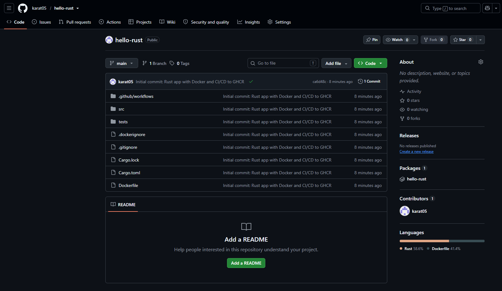

**Проверка опубликованного образа.** Команда `docker pull` скачала `ghcr.io/karat05/hello-rust:latest`; затем контейнер был запущен из GHCR и вывел ожидаемые результаты.

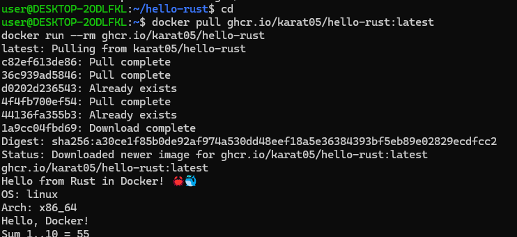

## CI/CD: публикация Go CLI в GHCR — задание 2 из 8

**Исходное задание:** [CI/CD на Go CLI с публикацией в GHCR](../../../content/DevOps/CI_CD/Pipelines/CI_CD_Go.md)

**Репозиторий:** [karat05/hello-go](https://github.com/karat05/hello-go)

**Пакет:** `ghcr.io/karat05/hello-go:latest`

### Цель

Добавить к проверкам Go-проекта публикацию готового Docker-образа в GitHub Container Registry. Workflow выполняет проверки кода на GitHub Actions и при push в `main` отправляет образ в GHCR.

### Ход выполнения

1. Создан Go-проект `hello-go` с пакетом `greeting`, функциями `Greet` и `SumRange`, а также unit-тестами.
2. Тесты запущены в контейнере `golang:1.23-alpine`, поэтому для проверки не требуется установленный Go на хосте.
3. Подготовлен многоэтапный Dockerfile: бинарный файл собирается в `golang:1.23-alpine`, а запускается в `alpine:3.20` под непривилегированным пользователем `appuser`.
4. Docker-образ собран локально и запущен. Проверены приветствие, ОС и архитектура контейнера, а также результат `Sum 1..10 = 55`.
5. В GitHub Actions настроены проверки `gofmt`, `go vet`, `go test` и сборка Go-приложения. При push в `main` workflow авторизуется в GHCR через `GITHUB_TOKEN` и публикует образ с тегами коммита и `latest`.
6. После публикации выполнен `docker logout ghcr.io`, затем образ скачан и запущен. Это проверяет доступность пакета без сохранённых учётных данных.

### Результат и скриншоты

**Проверка тестов.** Оба теста пакета `greeting` (`TestGreet` и `TestSumRange`) завершились успешно.

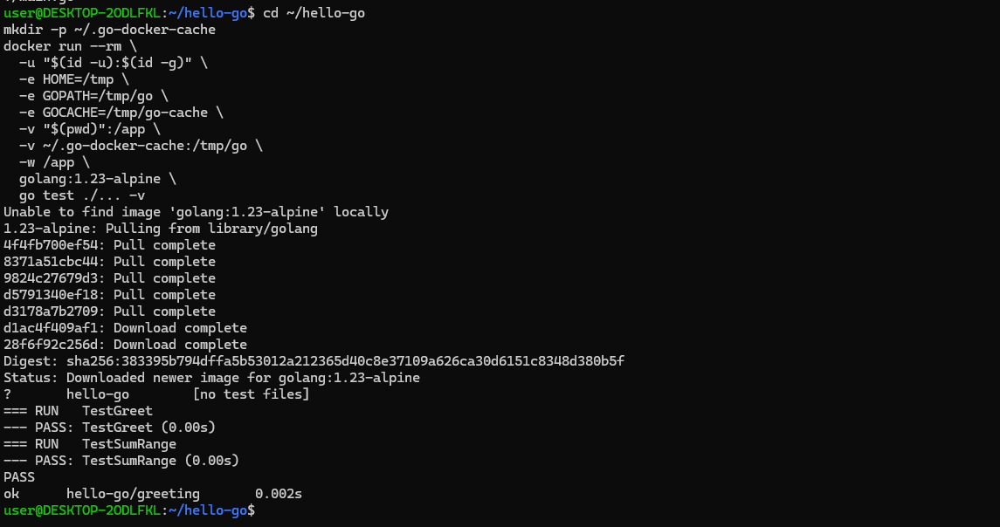

**Локальная Docker-сборка.** Сборка образа завершилась успешно. Запущенное приложение вывело `Hello from Go in Docker!`, `OS: linux`, `Arch: amd64` и сумму от 1 до 10.

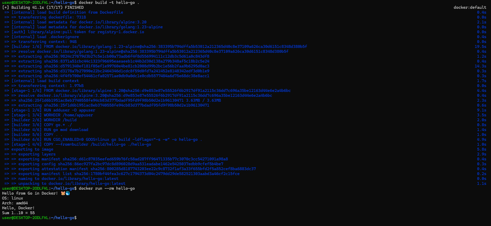

**Репозиторий и публикация.** Страница `hello-go` показывает зелёный статус коммита, а блок Packages — опубликованный пакет `hello-go`.

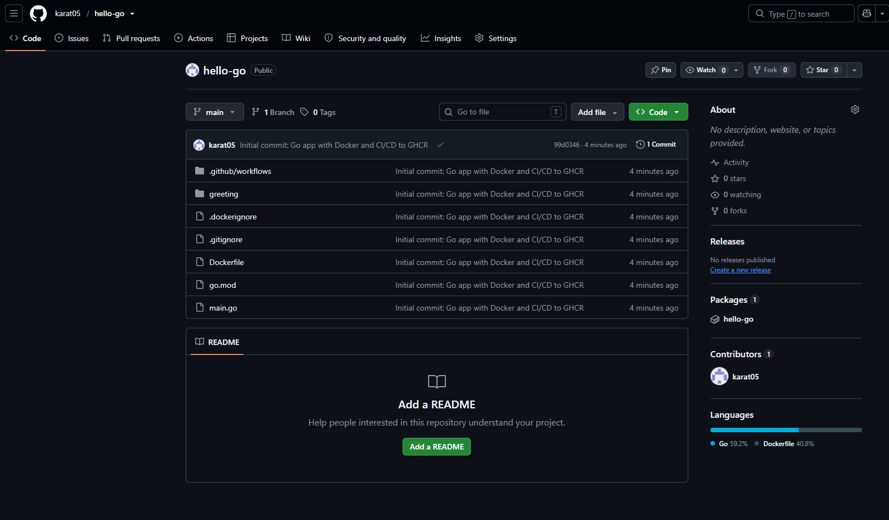

**Проверка опубликованного образа.** После выхода из GHCR команда `docker pull` скачала `ghcr.io/karat05/hello-go:latest`; запуск контейнера подтвердил, что образ доступен и приложение работает.

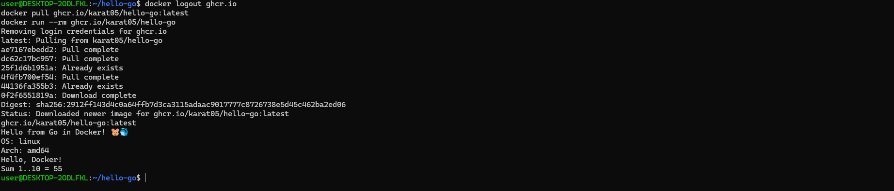

## CI/CD: Go CLI с публикацией бинарников в GitHub Releases — задание 3 из 8

**Исходное задание:** [CI/CD на Go с публикацией бинарников в GitHub Releases](../../../content/DevOps/CI_CD/Pipelines/Go_bin.md)

**Репозиторий:** [karat05/hello-go_bin](https://github.com/karat05/hello-go_bin)

**Релиз:** `v1.0.0`

### Цель

В этом задании приложение распространяется как готовый исполняемый файл. GitHub Actions запускает CI для кода, а при отправке тега версии собирает бинарники под Linux, macOS и Windows и прикладывает их к GitHub Release. Для запуска скачанного Linux-бинарника Docker не нужен.

### Ход выполнения

1. Подготовлен Go-проект `hello-go_bin` с пакетом `greeting`, функциями приветствия и вычисления суммы диапазона, а также unit-тестами.
2. Тесты выполнены в контейнере `golang:1.23-alpine`. Проверены `TestGreet` и `TestSumRange`.
3. Для CI настроены проверки форматирования и тесты. Для CD подготовлена сборка под пять сочетаний ОС и архитектур из задания преподавателя; версия передаётся в приложение при компиляции через `-ldflags`.
4. После успешных проверок создан и отправлен тег `v1.0.0`. GitHub Actions собрал файлы релиза и опубликовал GitHub Release.
5. Скачан артефакт `hello-go-linux-amd64`, добавлено право на запуск командой `chmod +x`, затем бинарник запущен непосредственно в Linux.

### Результат и скриншоты

**Тестирование.** Команда `go test ./... -v` выполнена в контейнере `golang:1.23-alpine`. Оба теста пакета `hello-go/greeting` завершились успешно.

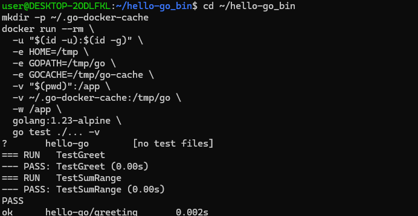

**GitHub Release.** На странице репозитория видны успешный статус workflow, тег и опубликованный релиз `v1.0.0`.

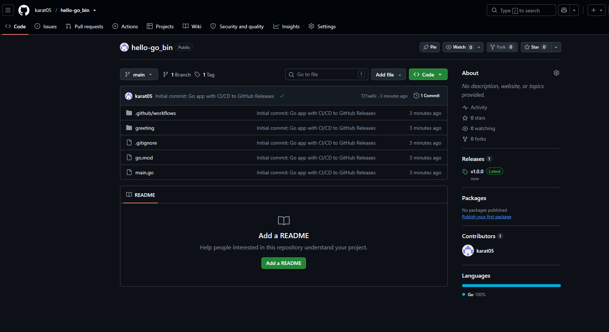

**Запуск скачанного бинарника.** Терминал показывает загрузку файла из GitHub Releases, изменение прав доступа и запуск. В выводе указаны версия `v1.0.0`, Linux, архитектура `amd64`, приветствие и результат `Sum 1..10 = 55`.

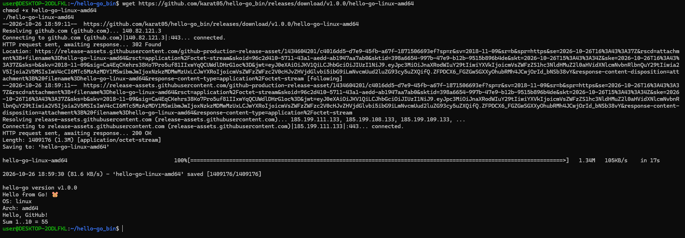

## CI/CD: Python CLI с PyInstaller и GitHub Releases — задание 4 из 8

**Исходное задание:** [CI/CD на Python CLI с публикацией бинарников в GitHub Releases](../../../content/DevOps/CI_CD/Pipelines/Python_PyInstaller_bin.md)

**Репозиторий:** [karat05/hello-python](https://github.com/karat05/hello-python)

**Релизы:** `v0.1.0` и `v0.2.0`

### Цель

Упаковать Python CLI вместе с интерпретатором в самостоятельный исполняемый файл с помощью PyInstaller и публиковать сборки в GitHub Releases. В отличие от Go, PyInstaller собирает приложение под текущую операционную систему, поэтому workflow использует отдельные runners для Linux, macOS и Windows.

### Ход выполнения

1. Подготовлены Python CLI `hello-python`, модуль `hello`, тесты `pytest` и workflow GitHub Actions.
2. Тесты запущены в Python 3.12 контейнере. Проверены приветствие и вычисление суммы диапазона.
3. PyInstaller собрал Linux-приложение в один файл. Для локальной проверки бинарник запущен в `debian:stable-slim`; в выводе показана версия `0.1.0`.
4. Workflow настроен на CI-проверки и запуск публикации при push тега `v*`. Для каждого релиза сборки делаются отдельно на runners Linux, macOS и Windows.
5. Создан релиз `v0.1.0`; скачан файл `hello-python-linux-x64` и проверен запуск в Linux.
6. Версия приложения обновлена до `0.2.0`, затем создан второй релиз. Новый бинарник скачан и запущен отдельно; предыдущий релиз сохранён.

### Результат и скриншоты

**Тесты.** Два теста (`test_greet` и `test_sum_range`) прошли успешно.

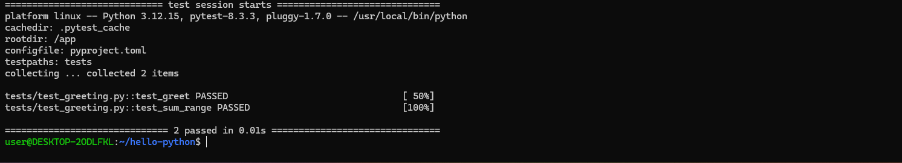

**Локальная сборка PyInstaller.** В контейнере Debian запущен собранный файл. Он вывел версию `0.1.0`, сведения об ОС и архитектуре, приветствие и сумму диапазона.

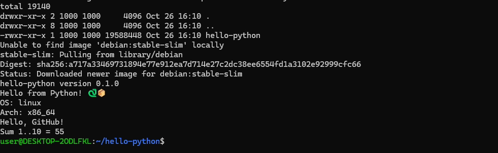

**Релиз `v0.1.0`.** Бинарник `hello-python-linux-x64` скачан из GitHub Releases, получил право на запуск и вывел версию `0.1.0`.

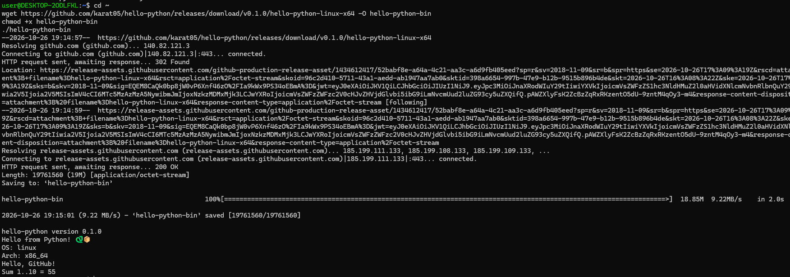

**Обновление до `v0.2.0`.** После обновления версии в проекте опубликован новый релиз. Снимок подтверждает, что скачанный бинарник показывает версию `0.2.0`.

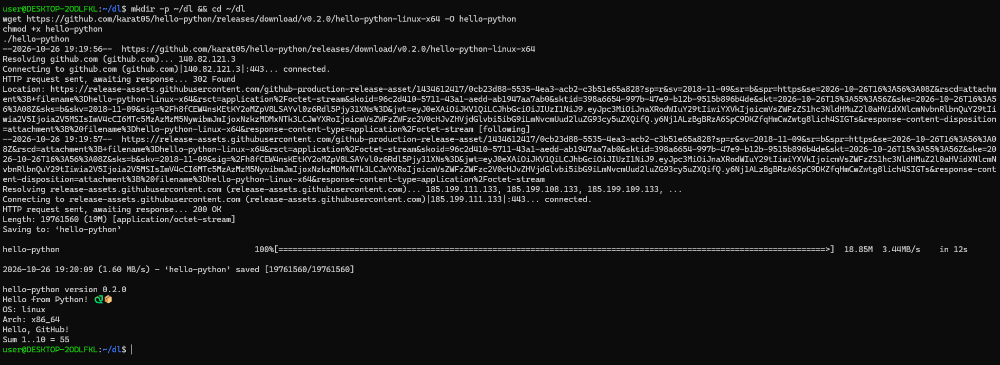

**Страница GitHub.** В репозитории отображаются оба релиза, `v0.2.0` отмечен как последний, а коммит обновления версии имеет успешный статус.

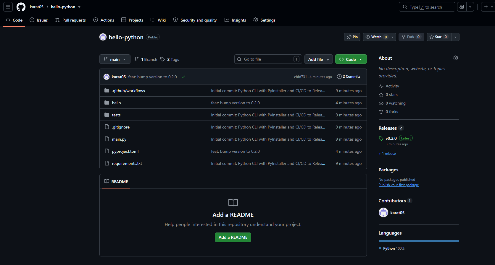

---

[К CI/CD заданиям за 2025 год](../2025/README.md) · [К оглавлению CI/CD](../README.md) · [К главной странице заметок](../../README.md)