# CI/CD: выполненные задания за 2026 год

> **Дата выполнения:** 26.10.2026

В отчёте собраны выполненные проекты по [заданиям преподавателя](../../../content/DevOps/CI_CD/README.md). Для каждого проекта подготовлен исходный код и workflow GitHub Actions. Снимки страниц репозиториев показывают структуру файлов и статус последнего коммита. Снимки терминала показывают локальную сборку и запуск Docker-образа, если такая проверка выполнялась.

## Содержание

| № | Проект | Репозиторий | Результат |
|:--:|:--|:--|:--|
| 1 | Python | [my-python-app](https://github.com/karat05/my-python-app-) | GitHub Actions и запуск Docker |
| 2 | Node.js | [my-node-app](https://github.com/karat05/my-node-app-) | GitHub Actions и Docker |
| 3 | Go | [my-go-app](https://github.com/karat05/my-go-app-) | GitHub Actions и Docker |
| 4 | Rust | [my-rust-app](https://github.com/karat05/my-rust-app-) | GitHub Actions и Docker |
| 5 | PHP | [my-php-app](https://github.com/karat05/my-php-app) | GitHub Actions и Docker |
| 6 | C++ | [my-cpp-app](https://github.com/karat05/my-cpp-app) | GitHub Actions и Docker |
| 7 | Java | [hello-java](https://github.com/karat05/hello-java) | GitHub Actions и Docker |
| 8 | Rust, дополнительный проект | [my-rust-app2](https://github.com/karat05/my-rust-app2) | GitHub Actions и Docker |

---

## 1. Python

**Репозиторий:** [karat05/my-python-app](https://github.com/karat05/my-python-app-)

### Ход выполнения

Подготовлено Python-приложение, тесты и workflow GitHub Actions. После настройки проекта образ `my-python-app:test` был запущен локально командой `docker run --rm my-python-app:test`.

### Скриншоты

Страница GitHub показывает файлы проекта и успешный статус коммита. Второй снимок показывает запуск контейнера и ожидаемое сообщение `Hello from my Python app!`.

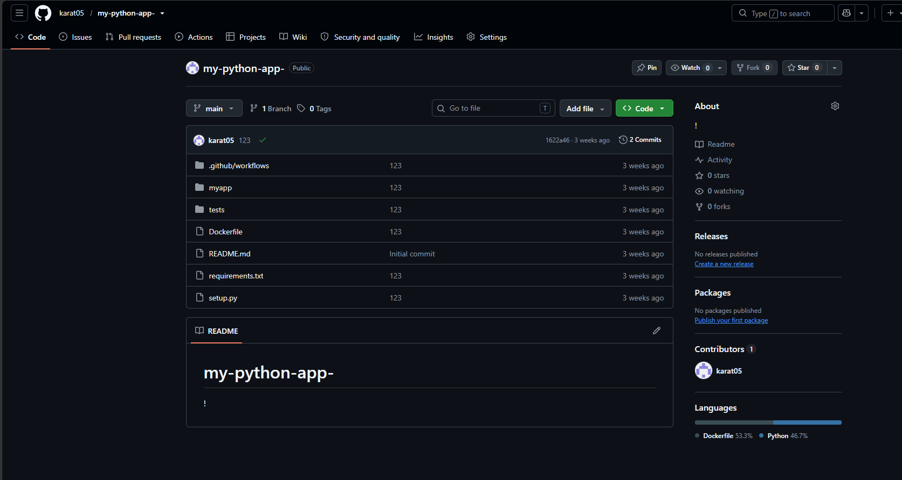

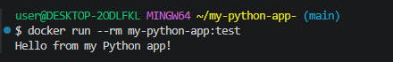

## 2. Node.js

**Репозиторий:** [karat05/my-node-app](https://github.com/karat05/my-node-app-)

### Ход выполнения

Добавлены исходный код, тесты, настройки ESLint и workflow для установки зависимостей, линтинга и тестирования. Затем собран Docker-образ `my-node-app:latest` и запущен контейнер.

### Скриншоты

На странице GitHub видны каталог workflow и файлы приложения; зелёная отметка рядом с коммитом подтверждает успешную проверку. В терминале видны завершившаяся сборка и вывод `Hello from Node.js app!`.

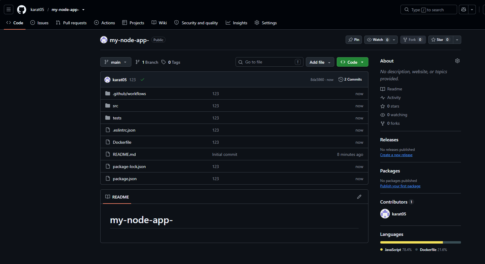

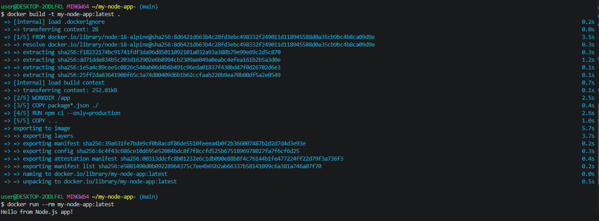

## 3. Go

**Репозиторий:** [karat05/my-go-app](https://github.com/karat05/my-go-app-)

### Ход выполнения

Подготовлены Go-модуль, функция сложения, тесты и workflow. Локально собран многоэтапный Docker-образ; запуск контейнера проверен по приветствию и результату вычисления `2 + 3 = 5`.

### Скриншоты

Снимок репозитория показывает исходные файлы, тест и workflow со статусом успешного коммита. Терминал показывает сборку образа и результат работы контейнера.

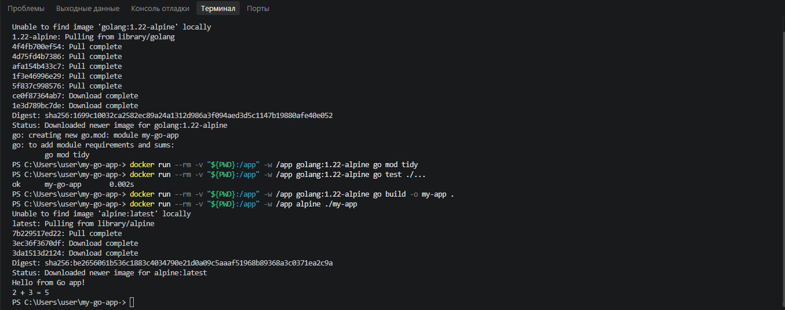

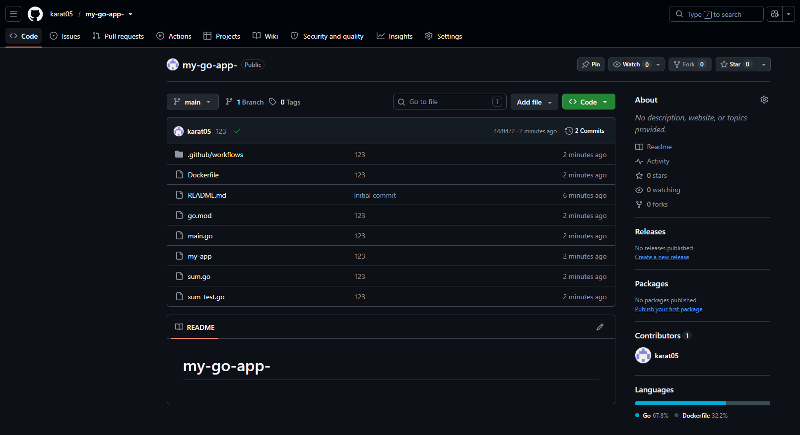

## 4. Rust

**Репозиторий:** [karat05/my-rust-app](https://github.com/karat05/my-rust-app-)

### Ход выполнения

Созданы проект Cargo, исходный файл и workflow для проверок Rust и сборки Docker-образа. Локально собран образ `my-rust-app:latest` и запущено приложение.

### Скриншоты

Страница GitHub подтверждает наличие Cargo-файлов, Dockerfile и workflow, а также показывает успешный статус коммита. Терминал показывает Docker-сборку и сообщение приложения `Hello from Rust in Docker!`.

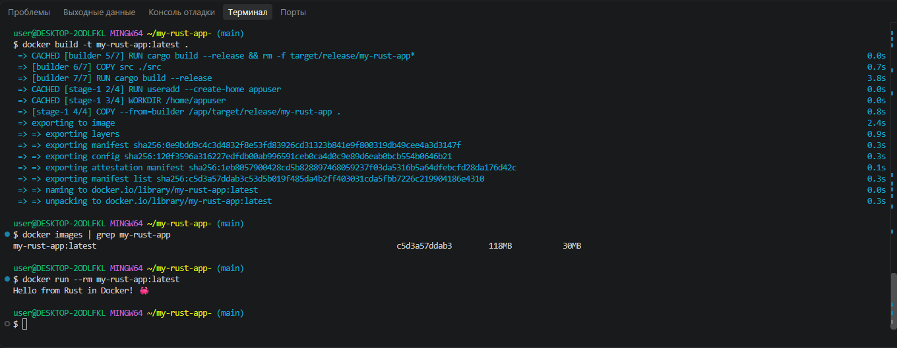

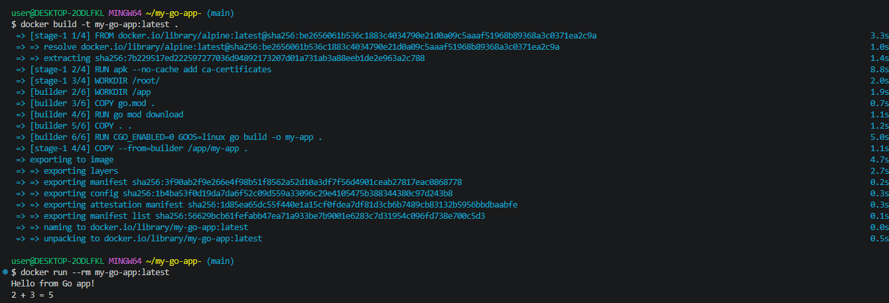

## 5. PHP

**Репозиторий:** [karat05/my-php-app](https://github.com/karat05/my-php-app)

### Ход выполнения

Подготовлены исходный код PHP-приложения, Dockerfile и workflow. Образ собран локально и запущен для проверки вывода приложения в контейнере.

### Скриншоты

На странице репозитория видны каталоги исходного кода, тестов и workflow, а также успешный статус коммита. В терминале показаны сборка образа и сообщение `Hello from PHP in Docker!`.

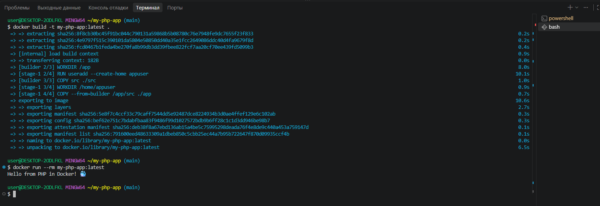

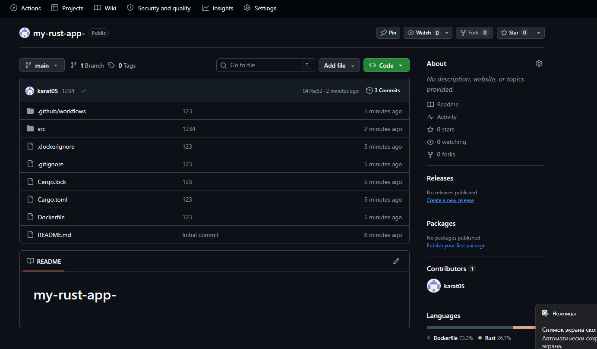

## 6. C++

**Репозиторий:** [karat05/my-cpp-app](https://github.com/karat05/my-cpp-app)

### Ход выполнения

Добавлены исходный код C++, конфигурация CMake, Dockerfile и workflow. Dockerfile собирает приложение внутри контейнера; после сборки контейнер был запущен для проверки результата.

### Скриншоты

Снимок GitHub показывает структуру C++-проекта и успешный статус коммита. Снимок терминала содержит команды сборки и запуска, а также ответ `Hello from C++ in Docker!`.

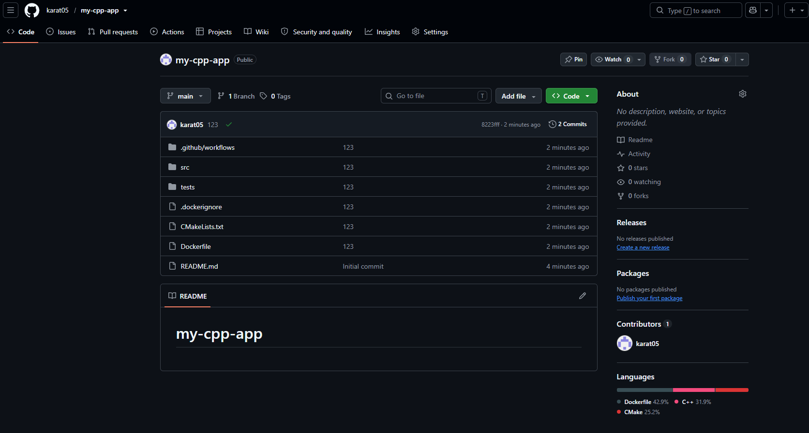

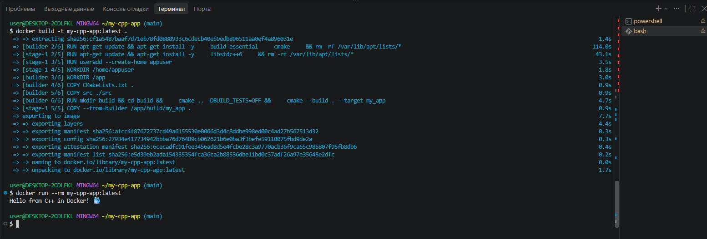

## 7. Java

**Репозиторий:** [karat05/hello-java](https://github.com/karat05/hello-java)

### Ход выполнения

Созданы Java-проект на Maven, Dockerfile и workflow. Локально собран образ `hello-java:latest`, после чего контейнер запустил JAR-файл приложения.

### Скриншоты

Страница GitHub показывает `pom.xml`, каталог исходного кода, Dockerfile и workflow, а также успешный статус коммита. Терминал показывает этапы сборки и результат запуска: `Hello from Java in Docker!` и версию Java.

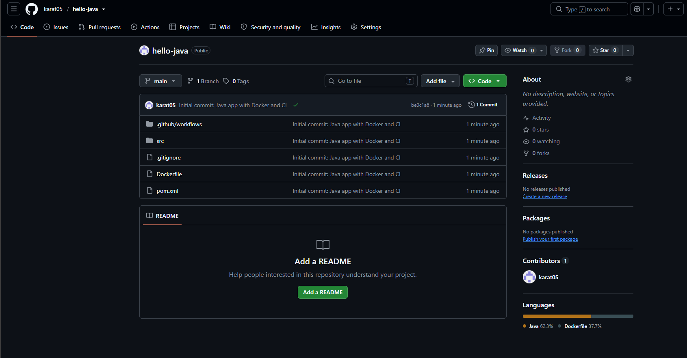

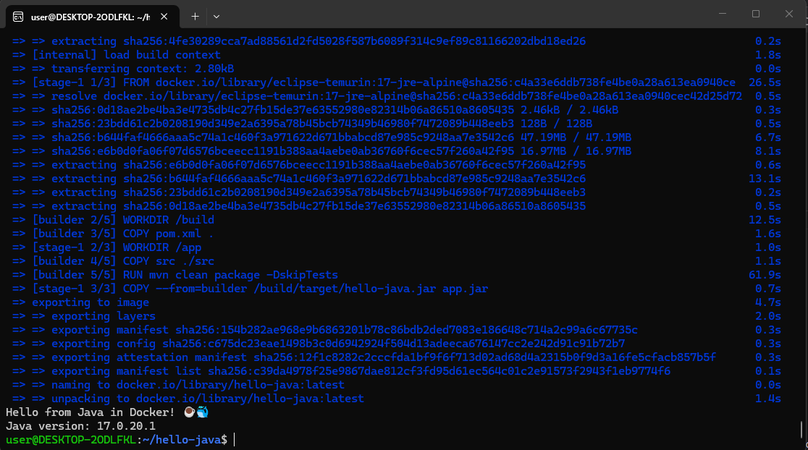

## 8. Rust — дополнительный проект

**Репозиторий:** [karat05/my-rust-app2](https://github.com/karat05/my-rust-app2)

### Ход выполнения

Подготовлены второй Rust-проект, Cargo-файлы, Dockerfile и workflow. Локально собран Docker-образ, проверено наличие образа и выполнен запуск приложения.

### Скриншоты

В репозитории видны файлы проекта и успешный статус коммита. Терминал показывает сборку образа, проверку через `docker images` и вывод `Hello from Rust in Docker!` при запуске.

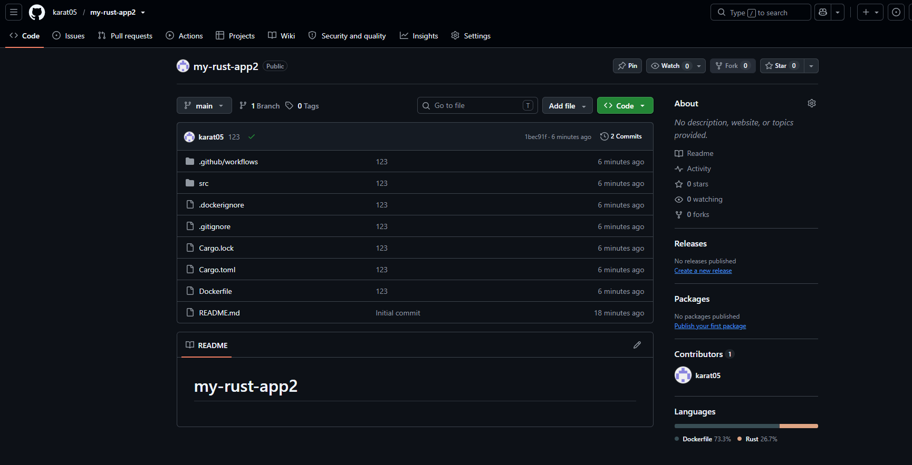

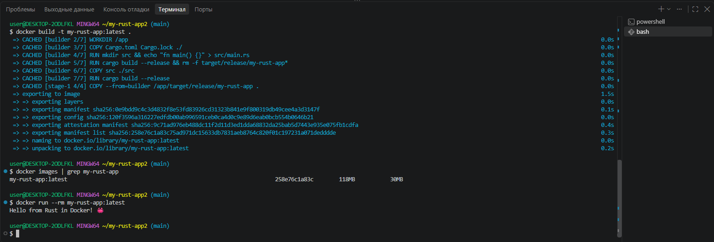

---

[К CI/CD заданиям за 2025 год](../2025/README.md) · [К оглавлению CI/CD](../README.md) · [К главной странице заметок](../../README.md)