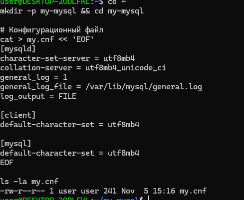
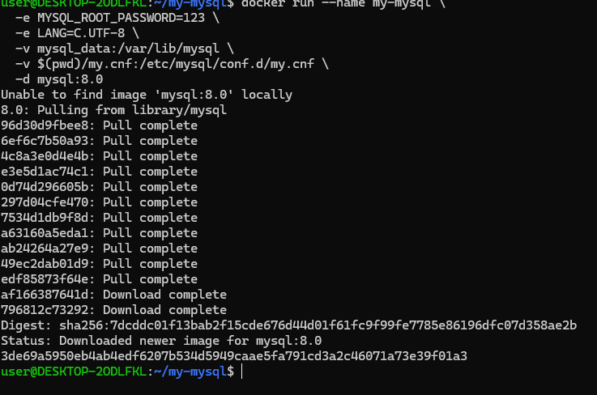
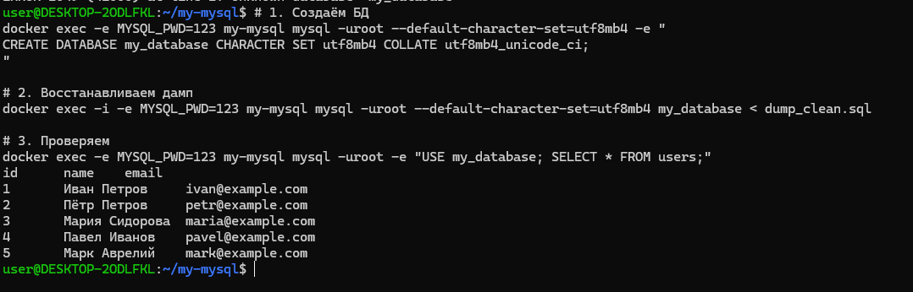
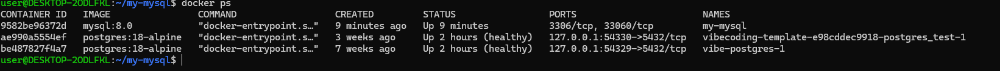
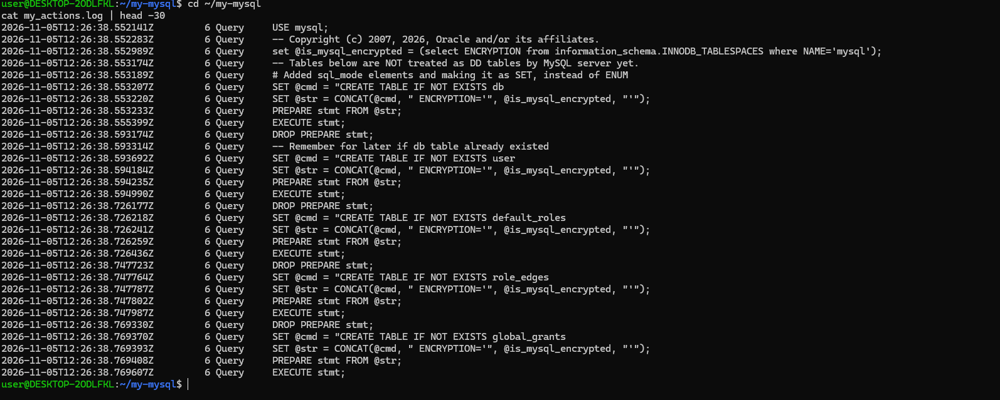
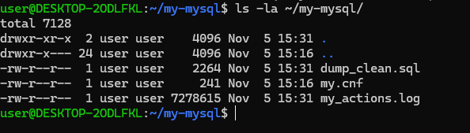
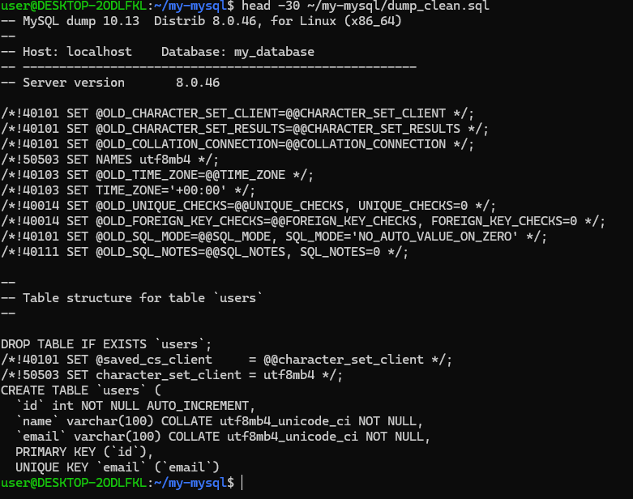
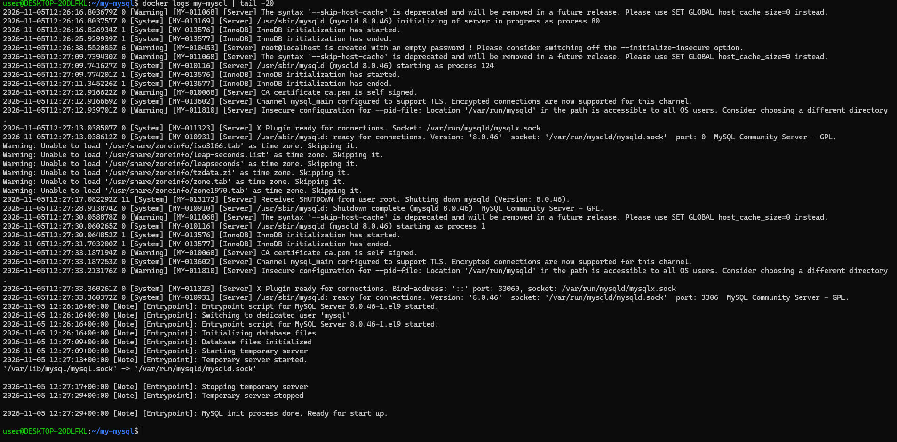

# Базы данных: выполненные задания

В этом разделе отдельно собрана практика по базам данных. Задания CI/CD остаются в [разделе CI/CD](../cicd/README.md).

## MySQL в Docker

- [Интерактивная работа с MySQL в изолированном окружении Docker № 1](README.md#mysql-docker-1)

---

## Интерактивная работа с MySQL в изолированном окружении Docker № 1

**Исходное задание:** [Begin_MySQL_1.md](../../content/Courses/Basics_database_design/content/bd/Begin_MySQL_1.md)

### Цель работы

Развернуть MySQL в отдельном Docker-контейнере, настроить кодировку `utf8mb4` и общий SQL-журнал, подключиться к серверу, создать базу и таблицу, восстановить SQL-дамп и проверить записи. В конце проверить состояние контейнера, журнал MySQL, резервный дамп и системные логи контейнера.

### Ход выполнения

1. Создан отдельный каталог `my-mysql` и конфигурация `my.cnf`. Для сервера заданы `utf8mb4` и `utf8mb4_unicode_ci`; включён общий журнал MySQL в `/var/lib/mysql/general.log` с выводом в файл. Кодировка `utf8mb4` также задана клиенту и интерактивной консоли.
2. Запущен контейнер `my-mysql` из образа `mysql:8.0`. Каталог данных подключён через именованный Docker volume `mysql_data`, а локальный `my.cnf` смонтирован в каталог конфигурации MySQL. Контейнер работает в фоне.
3. Через `docker exec` выполнены SQL-команды: создана база `my_database` с `utf8mb4_unicode_ci`, затем в неё восстановлен файл `dump_clean.sql`. Запрос `SELECT * FROM users` вывел пять строк — восстановленные записи пользователей.
4. Для проверки результата выполнена команда `docker ps`: MySQL-контейнер находится в статусе `Up`, образ — `mysql:8.0`.
5. Проверен журнал SQL-команд и системных сообщений MySQL; рабочие файлы проекта, включая `my.cnf`, `dump_clean.sql` и сохранённый журнал, находятся в каталоге `my-mysql`. Оригинальные [дамп](files/dump_clean.sql) и [журнал](files/my_actions.log) приложены к этому отчёту отдельными файлами.
6. Просмотрено содержимое `dump_clean.sql`. Это текстовый SQL-дамп: в нём есть структура таблицы `users`, поля `id`, `name`, `email`, первичный ключ и ограничение уникальности для email.
7. Командой `docker logs my-mysql` проверены сообщения контейнера. В конце лога MySQL сообщает, что инициализация завершена и сервер готов принимать соединения на порту 3306.

### Приложенные файлы

К отчёту добавлены исходные файлы из каталога `~/my-mysql`:

- [Скачать SQL-дамп `dump_clean.sql`](files/dump_clean.sql) — дамп базы `my_database` из MySQL 8.0.46 со схемой `users` и пятью строками данных.
- [Скачать журнал `my_actions.log`](files/my_actions.log) — сохранённый файл общего журнала MySQL; размер около 7,3 МБ.

Дамп содержит SQL для создания таблицы и вставки записей. Журнал приложен отдельным файлом, чтобы его можно было открыть или скачать независимо от скриншота.

### Скриншоты подготовки

Первые три изображения показывают последовательность подготовки и проверки данных перед оформлением подтверждений для сдачи.

**1. Конфигурация сервера.** Создан `my.cnf`: заданы кодировка, collation и параметры общего журнала MySQL.

**2. Запуск контейнера.** Docker загрузил образ `mysql:8.0` и создал контейнер `my-mysql` с volume для данных и подключённым конфигурационным файлом.

**3. Создание базы и проверка восстановления.** В терминале показаны команды создания `my_database`, восстановления `dump_clean.sql` и запрос к таблице `users`; в результате отображаются пять записей.

### Скриншоты для сдачи

Начиная с четвёртого снимка приведены подтверждения состояния контейнера, журналирования, резервного дампа и готовности сервера.

**4. Работающий контейнер.** `docker ps` показывает `my-mysql` со статусом `Up` и образом `mysql:8.0`.

**5. Журнал MySQL.** Просмотрен файл журнала с записями MySQL. Конфигурация `general_log` направляет общий журнал в файл внутри каталога данных сервера.

**6. Файлы проекта.** В `~/my-mysql` сохранены конфигурация `my.cnf`, SQL-дамп `dump_clean.sql` и файл журнала `my_actions.log`, скопированный для просмотра на хосте.

**7. Содержимое дампа.** В начале `dump_clean.sql` указаны MySQL 8.0.46 и база `my_database`; ниже виден SQL для создания таблицы `users` с полями `id`, `name`, `email`.

**8. Логи Docker-контейнера.** В выводе есть сообщения инициализации, а в конце — `ready for connections` и порт `3306`. В логах также встречаются предупреждения MySQL о параметрах и временных зонах; запуск завершился успешно.

---

[Вернуться к списку заданий по базам данных](README.md#mysql-docker-1) · [К оглавлению заметок](../README.md)
