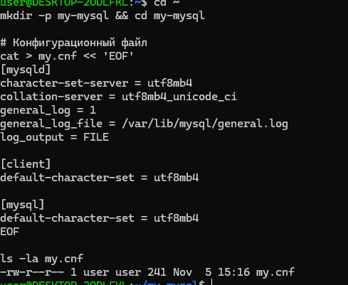
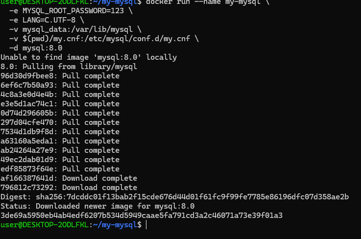
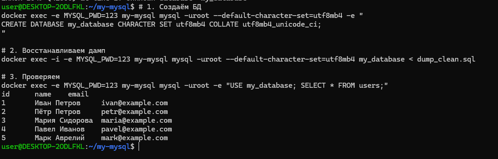
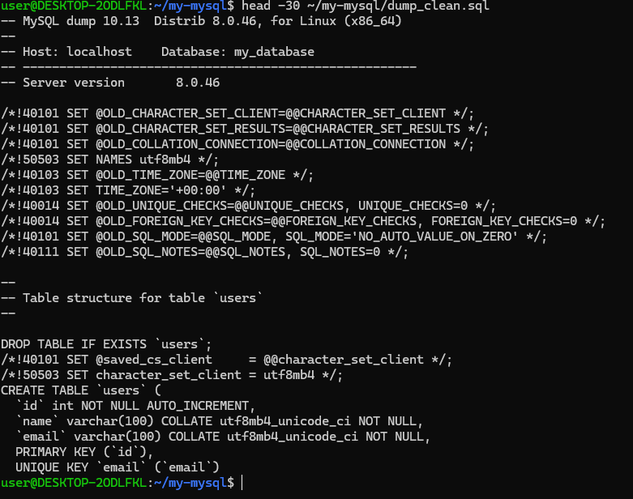
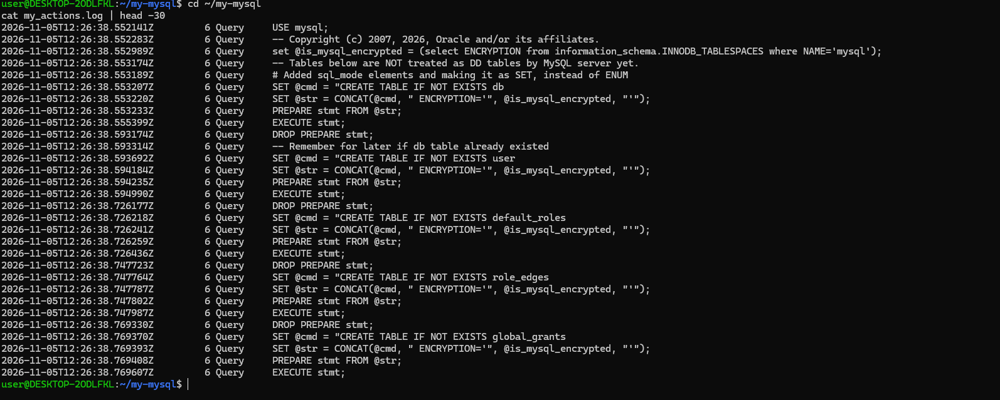
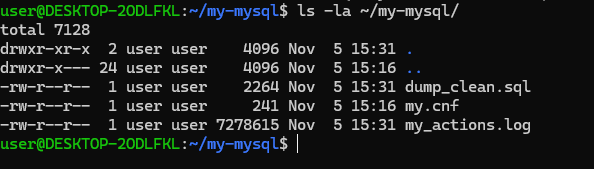
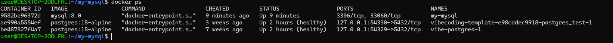
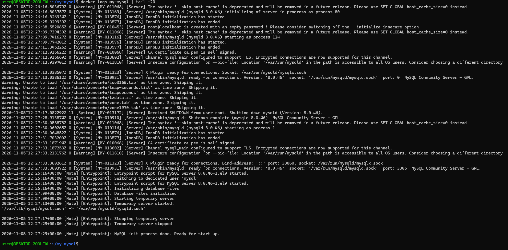

# MySQL в Docker — практическая работа № 1

Другие самостоятельные задания по базам данных: [задание № 2](mysql-2/README.md) · [задание № 3 — SQL-операции над товарами](products/README.md).

**Задание:** [Интерактивная работа с MySQL в изолированном окружении Docker № 1](../../content/Courses/Basics_database_design/content/bd/Begin_MySQL_1.md)<br>
**Где выполнялось:** WSL 2 с Docker Desktop, образ `mysql:8.0`.

В этой работе я поднял MySQL в отдельном контейнере, создал базу `my_database` и таблицу `users`, проверил данные, сохранил дамп и журнал SQL-запросов. Ниже описан мой ход работы; к каждому этапу приложены соответствующие скриншоты из WSL.

## Материалы работы

- [SQL-дамп базы `my_database`](files/dump_clean.sql)
- [Журнал SQL-действий `my_actions.log`](files/my_actions.log)

## Ход работы

### Шаг 1. Настроил MySQL и журнал запросов

В каталоге `~/my-mysql` создал `my.cnf`. Кодировку `utf8mb4` задал для сервера и клиента, а `general_log` включил для записи запросов в файл внутри контейнера.

```ini
[mysqld]
character-set-server = utf8mb4
collation-server = utf8mb4_unicode_ci
general_log = 1
general_log_file = /var/lib/mysql/general.log
log_output = FILE

[client]
default-character-set = utf8mb4

[mysql]
default-character-set = utf8mb4
```

**Скриншот 1.** Создание каталога проекта и содержимое файла конфигурации.



### Шаг 2. Запустил контейнер

Из каталога с конфигурацией запустил официальный образ MySQL 8.0. Volume `mysql_data` хранит данные базы отдельно от контейнера.

```bash
cd ~/my-mysql

docker run --name my-mysql \
  -e MYSQL_ROOT_PASSWORD=123 \
  -e LANG=C.UTF-8 \
  -v mysql_data:/var/lib/mysql \
  -v "$(pwd)/my.cnf":/etc/mysql/conf.d/my.cnf \
  -d mysql:8.0
```

Пароль `123` использовался только для учебного окружения. После запуска убедился, что Docker создал контейнер.

**Скриншот 2.** Запуск MySQL-контейнера в WSL.



### Шаг 3. Создал базу и проверил таблицу

Подключился к серверу через клиент `mysql`, создал `my_database` и таблицу `users`. В таблицу добавил пять записей и проверил их запросом `SELECT`.

```bash
docker exec -it my-mysql \
  mysql --default-character-set=utf8mb4 -uroot -p
```

Команды SQL в интерактивной оболочке:

```sql
CREATE DATABASE my_database
  CHARACTER SET utf8mb4
  COLLATE utf8mb4_unicode_ci;

USE my_database;

CREATE TABLE users (
    id INT AUTO_INCREMENT PRIMARY KEY,
    name VARCHAR(100) NOT NULL,
    email VARCHAR(100) NOT NULL UNIQUE
) CHARACTER SET utf8mb4 COLLATE utf8mb4_unicode_ci;

INSERT INTO users (name, email) VALUES
  ('Иван Петров', 'ivan@example.com'),
  ('Пётр Петров', 'petr@example.com'),
  ('Мария Сидорова', 'maria@example.com'),
  ('Павел Иванов', 'pavel@example.com'),
  ('Марк Аврелий', 'mark@example.com');

SELECT * FROM users;
```

В MySQL 8.0 таблица использует InnoDB по умолчанию. На скриншоте видны команды работы с базой и результат выборки.

**Скриншот 3.** Создание базы, восстановление SQL-файла и проверка пяти записей в `users`.



### Шаг 4. Сохранил дамп и проверил восстановление

Экспортировал базу в `dump_clean.sql` с помощью `mysqldump`. Затем загрузил дамп обратно в `my_database` и повторно вывел строки таблицы, чтобы убедиться, что данные восстановились.

```bash
docker exec -e MYSQL_PWD=123 my-mysql mysqldump -uroot \
  --set-gtid-purged=OFF \
  --single-transaction \
  my_database > dump_clean.sql

# Очищаю старые записи до проверки восстановления
docker exec my-mysql sh -c ': > /var/lib/mysql/general.log'

docker exec -i -e MYSQL_PWD=123 my-mysql \
  mysql --default-character-set=utf8mb4 -uroot my_database \
  < dump_clean.sql

docker exec -e MYSQL_PWD=123 my-mysql mysql -uroot -e \
  "USE my_database; SELECT * FROM users;"
```

Файл дампа — самостоятельный артефакт работы, его можно скачать в начале README. На следующем снимке показан заголовок дампа и описание таблицы `users`.

**Скриншот 4.** Просмотр SQL-дампа перед восстановлением.



### Шаг 5. Выгрузил журнал запросов

Сначала очистил общий журнал от предыдущих записей, затем сохранил выполненные SQL-действия в `my_actions.log`. Из журнала убраны типовые команды сессии и блокировки, добавляемые при экспорте дампа; оставлены действия с таблицей.

```bash
docker exec my-mysql cat /var/lib/mysql/general.log \
  | grep "Query" \
  | grep -viE 'Query[[:space:]]+(/\*!|SET[[:space:]]|SELECT @@|LOCK TABLES|UNLOCK TABLES|SHOW[[:space:]])' \
  > my_actions.log
```

В сохранённом логе видны удаление старой таблицы при импорте, создание `users`, вставка записей и их чтение. Полный журнал приложен отдельным файлом.

**Скриншоты 5–6.** Просмотр журнала запросов и файлов проекта в WSL. В каталоге сдачи дамп и итоговый лог приложены отдельно.





### Шаг 6. Проверил контейнер и состояние сервера

Проверил, что контейнер `my-mysql` работает, и просмотрел последние сообщения Docker-логов. Строка `ready for connections` означает, что сервер MySQL готов принимать подключения.

```bash
docker ps --filter name=my-mysql
docker logs my-mysql --tail 20
ls -lh dump_clean.sql my_actions.log
```

**Скриншот 7.** Контейнер MySQL виден в выводе `docker ps`.



**Скриншот 8.** Системные сообщения контейнера и статус готовности MySQL.



## Что сдано

| Артефакт | Что в нём находится |
| --- | --- |
| [`dump_clean.sql`](files/dump_clean.sql) | Структура таблицы `users` и данные из базы `my_database`. |
| [`my_actions.log`](files/my_actions.log) | Основные SQL-действия, оставленные после очистки журнала от технических команд экспорта. |
| `images/` | Мои скриншоты настройки, запуска контейнера, работы с базой, дампом и логами. |

## Итог

MySQL работает в отдельном Docker-контейнере. База и таблица созданы, данные проверены до и после восстановления дампа, журнал SQL-действий сохранён рядом с README. Для заметок по другим учебным работам: [оглавление](../README.md) · [CI/CD](../cicd/README.md).
