# MySQL в Docker — практическая работа № 2

**Задание:** [Интерактивная работа с MySQL в изолированном окружении Docker № 2](https://github.com/rurewa/imfua/blob/main/content/Courses/Basics_database_design/content/bd/Begin_MySQL_2.md)  
**Среда:** WSL 2, Docker Desktop, контейнер `my-mysql`, MySQL 8.0.

В этой работе я использую предыдущий контейнер, но переключаю общий журнал MySQL на таблицу `mysql.general_log`. В отдельной базе `sql_practice` создаются клиенты и заказы, затем выполняются запросы от простых выборок до соединений, группировок и подзапросов. В конце журнал экспортируется, база сохраняется в дамп, удаляется и восстанавливается из этого дампа.

> **Как различать команды:** в терминале WSL приглашение заканчивается на `$`; внутри клиента MySQL — на `mysql>`. SQL вводится только после `docker exec ... mysql` и появления `mysql>`. Команда `\q` закрывает клиент и возвращает в WSL Bash; после неё нужно снова подключиться, прежде чем вводить следующий SQL-блок.

Если Bash-команды случайно введены в `mysql>` и появились строки `->`, нажать `Ctrl+C`, чтобы отменить незаконченный ввод и вернуться к `mysql>`. После этого выйти через `\q` и выполнять команды WSL только при приглашении `$`.

По присланным снимкам подтверждены шаги 1–9: настройка журнала, VIEW, таблицы, вставка и выборка данных, JOIN, подзапросы, `UNION`, `UPDATE`, `DELETE` и `ALTER TABLE`. В VIEW обнаружилось попадание строчной служебной команды клиента; перед экспортом исправить фильтр без повторения предыдущих шагов.

## План и ход выполнения

### 1. Переключение журнала MySQL на таблицу

В WSL перейти в `~/my-mysql` и заменить настройки `my.cnf`. Для фильтрации журнала через SQL-представление нужен `log_output = TABLE`; старую настройку `general_log_file` удалить.

```bash
cd ~/my-mysql
cat > my.cnf <<'EOF'
[mysqld]
character-set-server = utf8mb4
collation-server = utf8mb4_unicode_ci
general_log = 1
log_output = TABLE

[client]
default-character-set = utf8mb4

[mysql]
default-character-set = utf8mb4
EOF

docker restart my-mysql
```

Проверить настройки после перезапуска:

```bash
docker exec -it my-mysql mysql --default-character-set=utf8mb4 -uroot -p
```

```sql
SHOW VARIABLES LIKE 'general_log%';
SHOW VARIABLES LIKE 'log_output';
```

Ожидаемые значения: `general_log` включён, `log_output` равен `TABLE`. Если контейнер ещё запускается, подождать 10–20 секунд и подключиться повторно. Не запускать `docker volume prune -a`: команда может удалить тома других проектов, а существующий `mysql_data` нужен для текущего контейнера.

**Скриншот к шагу 1:** обновлённый `my.cnf`, перезапуск контейнера и проверка переменных MySQL.  
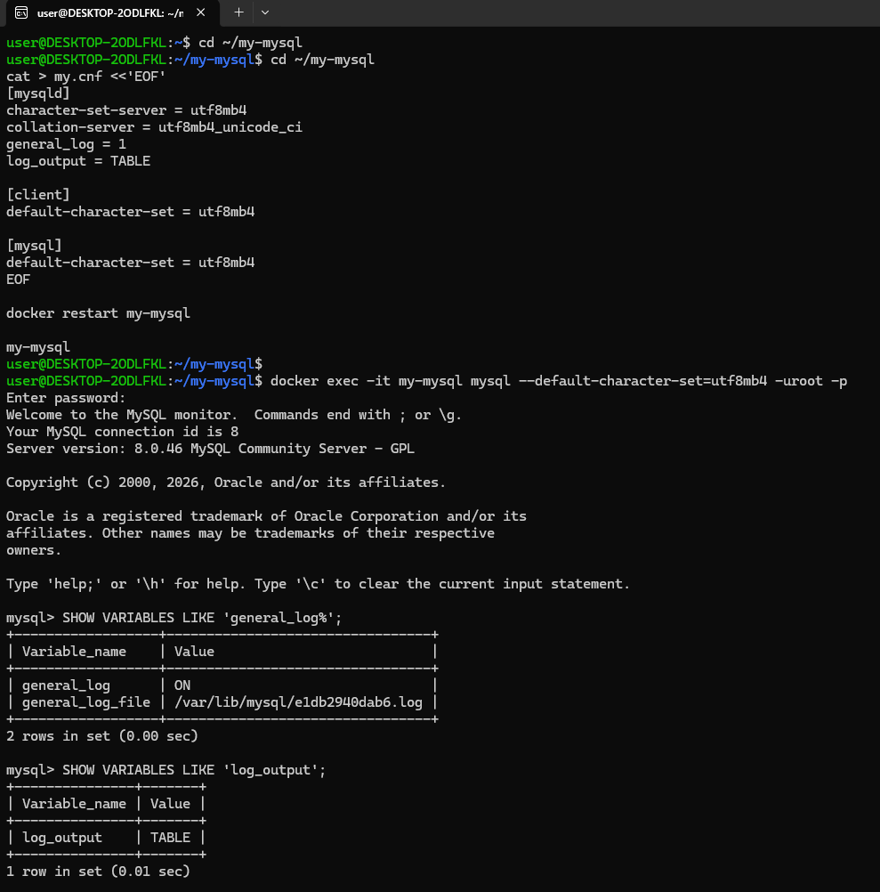

### 2. Создание учебной базы и VIEW журнала

В клиенте MySQL создать базу, переключиться в неё и создать представление `my_actions`. Представление выбирает только запросы пользователя `root` и исключает команды настройки, диагностические запросы и собственное чтение VIEW.

```sql
CREATE DATABASE sql_practice
  CHARACTER SET utf8mb4
  COLLATE utf8mb4_unicode_ci;
USE sql_practice;
SHOW DATABASES;
SHOW TABLES;

CREATE OR REPLACE VIEW my_actions AS
SELECT event_time,
       command_type,
       CONVERT(argument USING utf8mb4) AS argument
FROM mysql.general_log
WHERE user_host LIKE '%root%'
  AND command_type = 'Query'
  AND (
      LOWER(CONVERT(argument USING utf8mb4)) LIKE 'create database sql_practice%'
      OR LOWER(CONVERT(argument USING utf8mb4)) LIKE 'create table customers%'
      OR LOWER(CONVERT(argument USING utf8mb4)) LIKE 'create table orders%'
      OR LOWER(CONVERT(argument USING utf8mb4)) LIKE 'insert into customers%'
      OR LOWER(CONVERT(argument USING utf8mb4)) LIKE 'insert into orders%'
      OR (LOWER(CONVERT(argument USING utf8mb4)) LIKE 'select %'
          AND (LOWER(CONVERT(argument USING utf8mb4)) LIKE '%from customers%'
               OR LOWER(CONVERT(argument USING utf8mb4)) LIKE '%from orders%'))
      OR LOWER(CONVERT(argument USING utf8mb4)) LIKE 'update customers%'
      OR LOWER(CONVERT(argument USING utf8mb4)) LIKE 'update orders%'
      OR LOWER(CONVERT(argument USING utf8mb4)) LIKE 'delete from orders%'
      OR LOWER(CONVERT(argument USING utf8mb4)) LIKE 'alter table customers%'
      OR LOWER(CONVERT(argument USING utf8mb4)) LIKE 'drop table orders%'
      OR LOWER(CONVERT(argument USING utf8mb4)) LIKE 'drop table customers%'
      OR LOWER(CONVERT(argument USING utf8mb4)) LIKE 'drop database sql_practice%'
  );

SHOW FULL TABLES WHERE Table_type = 'VIEW';
SELECT * FROM my_actions ORDER BY event_time DESC LIMIT 20;
```

`FROM mysql.general_log` указан явно, потому что журнал находится в системной базе `mysql`, а VIEW создаётся в `sql_practice`.

**Скриншот к шагу 2:** создание базы и `my_actions`, список VIEW и первая проверка журнала.  
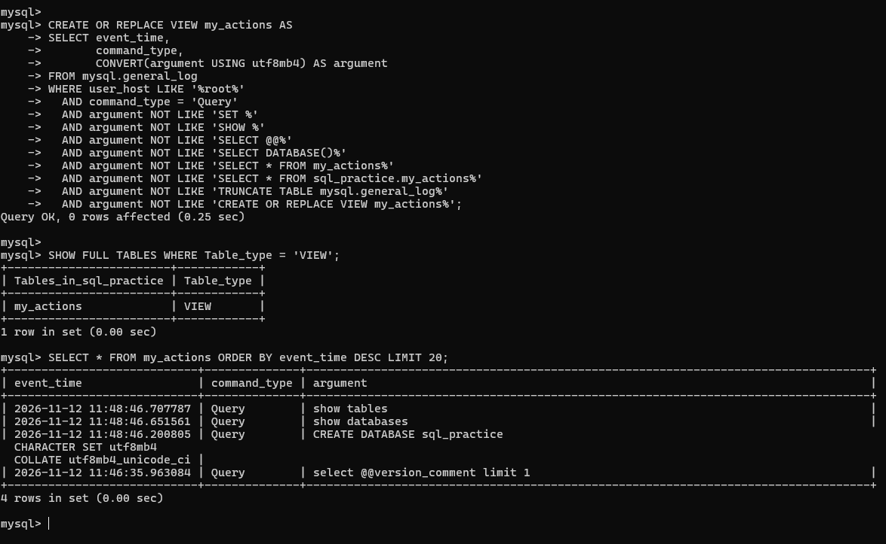

При проверке выяснилось, что таблица журнала содержит и автоматические запросы MySQL-клиента. Поэтому итоговое VIEW оставляет только команды работы с учебной базой и таблицами; диагностические и служебные обращения в него не попадают.

Переходить к удалению базы на шаге 11 можно только после того, как повторный просмотр `my_actions` показывает действия с `customers`/`orders`, без строк `SAVEPOINT`, `INFORMATION_SCHEMA` и команд клиента. Если они остались, повторно выполнить `CREATE OR REPLACE VIEW`, дождаться `Query OK`, и только затем запускать `SELECT` для проверки.

### 3. Создание связанных таблиц

Создать `customers` и `orders`. Внешний ключ `orders.customer_id` связывает каждый заказ с клиентом. После создания посмотреть таблицы и структуру столбцов.

```sql
CREATE TABLE customers (
    id INT AUTO_INCREMENT PRIMARY KEY,
    name VARCHAR(100) NOT NULL,
    email VARCHAR(100) NOT NULL UNIQUE,
    city VARCHAR(100),
    created_at TIMESTAMP DEFAULT CURRENT_TIMESTAMP
) CHARACTER SET utf8mb4 COLLATE utf8mb4_unicode_ci;

CREATE TABLE orders (
    id INT AUTO_INCREMENT PRIMARY KEY,
    customer_id INT NOT NULL,
    order_date DATE NOT NULL,
    amount DECIMAL(10, 2) NOT NULL,
    status VARCHAR(20) DEFAULT 'new',
    FOREIGN KEY (customer_id) REFERENCES customers(id)
) CHARACTER SET utf8mb4 COLLATE utf8mb4_unicode_ci;

SHOW TABLES;
DESCRIBE customers;
DESCRIBE orders;
```

Для просмотра файлов InnoDB выйти из клиента командой `\q`, затем выполнить:

```bash
docker exec -it my-mysql ls -la /var/lib/mysql/sql_practice
```

**Скриншот к шагу 3:** схема обеих таблиц и список файлов базы в контейнере.  
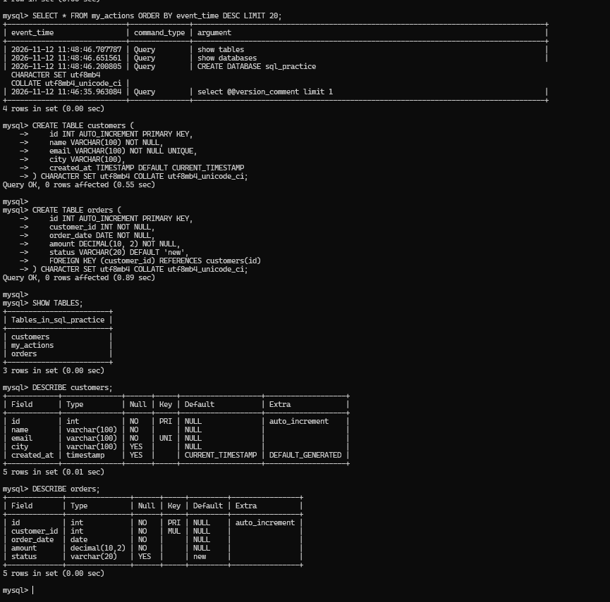

Второй снимок шага показывает файлы таблиц InnoDB после выхода из клиента через `\q`.

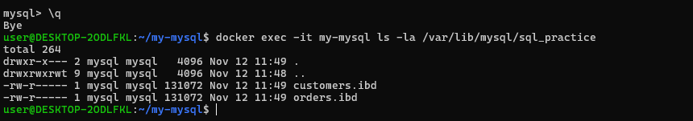

### 4. Заполнение таблиц тестовыми данными

После просмотра файлов на прошлом шаге приглашение снова заканчивается на `$`: это WSL Bash. Сначала заново открой клиент MySQL, введи пароль `123` и дождись приглашения `mysql>`. Затем выбери `sql_practice`, проверь пустые таблицы, добавь пять клиентов и шесть заказов, и убедись, что записи появились.

Команда подключения вводится в WSL Bash:

```bash
docker exec -it my-mysql mysql --default-character-set=utf8mb4 -uroot -p
```

Только после появления `mysql>` вводи следующий SQL-блок:

```sql
USE sql_practice;
SHOW TABLES;
SELECT * FROM customers;
SELECT * FROM orders;

INSERT INTO customers (name, email, city) VALUES
  ('Иван Иванов', 'ivan@example.com', 'Москва'),
  ('Пётр Петров', 'petr@example.com', 'Санкт-Петербург'),
  ('Мария Сидорова', 'maria@example.com', 'Москва'),
  ('Алексей Смирнов', 'alex@example.com', 'Казань'),
  ('Ольга Кузнецова', 'olga@example.com', 'Новосибирск');

INSERT INTO orders (customer_id, order_date, amount, status) VALUES
  (1, '2026-10-01', 1500.00, 'paid'),
  (1, '2026-10-05', 2300.50, 'paid'),
  (2, '2026-10-03', 800.00, 'new'),
  (3, '2026-10-07', 4200.00, 'paid'),
  (3, '2026-10-10', 1100.00, 'cancelled'),
  (4, '2026-10-12', 950.00, 'new');

SELECT * FROM customers;
SELECT * FROM orders;
```

**Скриншот к шагу 4:** результаты выборки обеих таблиц после вставки.  
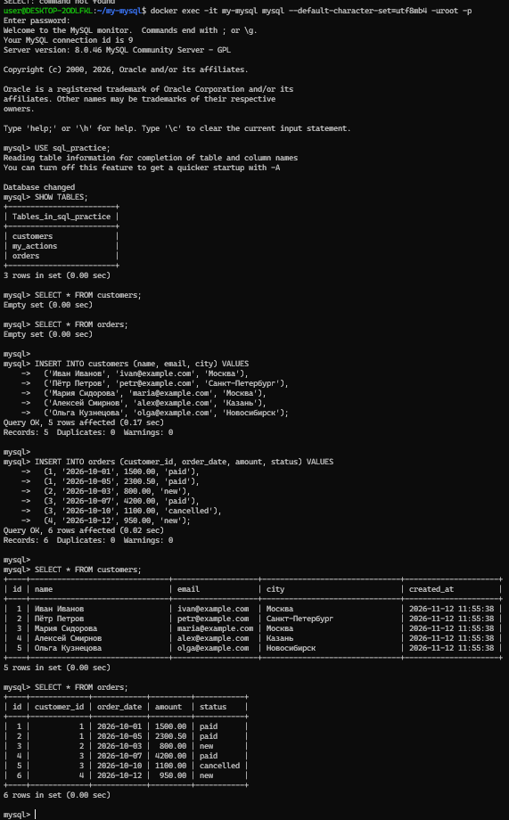

### 5. Выборки, условия и сортировка

Последовательно выполнить разные варианты `SELECT`: выбрать все поля, только нужные столбцы, отфильтровать строки по городу, сумме и статусу, отсортировать результаты, ограничить число строк и попробовать поиск по шаблону.

```sql
SELECT * FROM customers;
SELECT name, city FROM customers;
SELECT * FROM customers WHERE city = 'Москва';
SELECT * FROM orders WHERE amount > 1000;
SELECT * FROM orders WHERE status = 'paid' AND amount > 1500;
SELECT * FROM orders WHERE status = 'new' OR status = 'cancelled';
SELECT * FROM customers ORDER BY name;
SELECT * FROM orders ORDER BY amount DESC;
SELECT * FROM orders ORDER BY order_date DESC, amount ASC;
SELECT * FROM orders ORDER BY amount DESC LIMIT 3;
SELECT * FROM customers WHERE name LIKE 'И%';
SELECT * FROM customers WHERE email LIKE '%@example.com';
SELECT * FROM orders WHERE amount BETWEEN 1000 AND 3000;
SELECT * FROM customers WHERE city IN ('Москва', 'Казань');
SELECT * FROM customers WHERE city IS NULL;
```

**Скриншот к шагу 5:** несколько выборок с `WHERE`, `ORDER BY`, `LIMIT`, `LIKE`, `BETWEEN` и `IN`.  
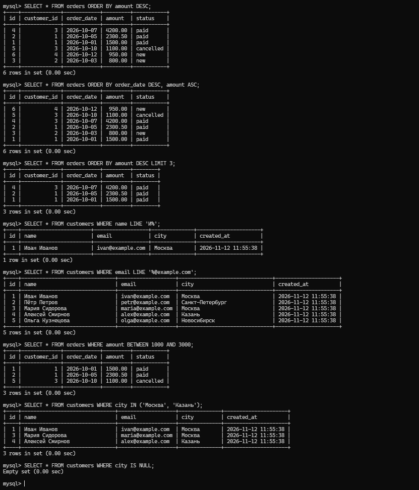

### 6. Агрегаты и группировка

Посчитать количество заказов, сумму, среднее, минимум и максимум. Затем сгруппировать суммы по клиентам и отфильтровать группы через `HAVING`.

```sql
SELECT COUNT(*) AS total_orders FROM orders;
SELECT SUM(amount) AS total_sum FROM orders;
SELECT AVG(amount) AS avg_amount FROM orders;
SELECT MIN(amount) AS min_amount, MAX(amount) AS max_amount FROM orders;

SELECT customer_id, COUNT(*) AS order_count, SUM(amount) AS total_amount
FROM orders
GROUP BY customer_id;

SELECT c.name, COUNT(o.id) AS order_count, SUM(o.amount) AS total_amount
FROM customers c
JOIN orders o ON c.id = o.customer_id
GROUP BY c.id, c.name
ORDER BY total_amount DESC;

SELECT customer_id, SUM(amount) AS total_amount
FROM orders
GROUP BY customer_id
HAVING SUM(amount) > 2000;
```

**Скриншот к шагу 6:** результаты агрегатов, `GROUP BY` и `HAVING`.  
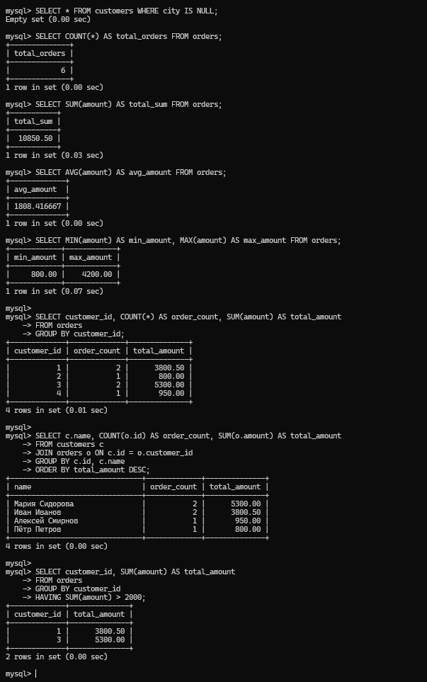

### 7. Соединения таблиц

Сравнить `INNER JOIN`, `LEFT JOIN` и `RIGHT JOIN`. Затем использовать `JOIN` вместе с агрегатами и `COALESCE`, чтобы показать ноль для клиентов без заказов.

```sql
SELECT c.name, o.order_date, o.amount, o.status
FROM customers c
INNER JOIN orders o ON c.id = o.customer_id;

SELECT c.name, o.id AS order_id, o.amount
FROM customers c
LEFT JOIN orders o ON c.id = o.customer_id;

SELECT c.name, o.id AS order_id
FROM customers c
RIGHT JOIN orders o ON c.id = o.customer_id;

SELECT c.name,
       COUNT(o.id) AS order_count,
       COALESCE(SUM(o.amount), 0) AS total_amount
FROM customers c
LEFT JOIN orders o ON c.id = o.customer_id
GROUP BY c.id, c.name
ORDER BY total_amount DESC;
```

**Скриншот к шагу 7:** соединение клиентов и заказов с именами клиентов.  
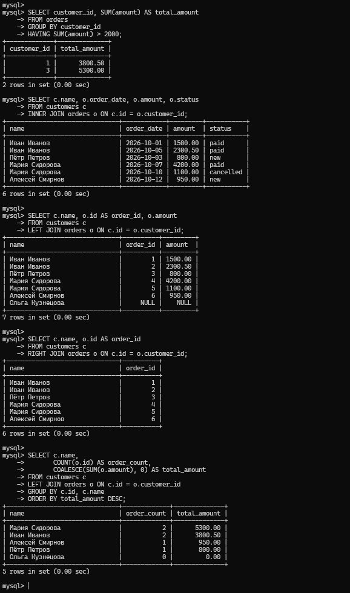

### 8. Подзапросы и UNION

Выполнить подзапросы в `WHERE`, `FROM` и `SELECT`, проверить `EXISTS`/`NOT EXISTS`, а затем объединить результаты оператором `UNION` и сравнить с `UNION ALL`.

```sql
SELECT name, city FROM customers
WHERE id IN (SELECT customer_id FROM orders WHERE amount > 1000);

SELECT name, city FROM customers
WHERE id = (SELECT customer_id FROM orders ORDER BY amount DESC LIMIT 1);

SELECT c.name, o.total
FROM customers c
JOIN (
    SELECT customer_id, SUM(amount) AS total
    FROM orders GROUP BY customer_id
) o ON c.id = o.customer_id
WHERE o.total > 2000;

SELECT c.name,
       (SELECT COUNT(*) FROM orders o WHERE o.customer_id = c.id) AS order_count
FROM customers c;

SELECT name FROM customers c
WHERE EXISTS (SELECT 1 FROM orders o WHERE o.customer_id = c.id);

SELECT name FROM customers c
WHERE NOT EXISTS (SELECT 1 FROM orders o WHERE o.customer_id = c.id);

SELECT name, city FROM customers WHERE city = 'Москва'
UNION
SELECT name, city FROM customers WHERE city = 'Казань';

SELECT city FROM customers
UNION ALL
SELECT city FROM customers;
```

**Скриншот к шагу 8:** результат подзапроса и объединения строк через `UNION`.  
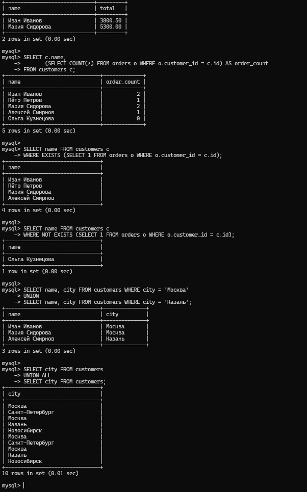

### 9. Изменение записей и схемы таблицы

Обновить город клиента и статус заказа, проверить изменения. Удалить заказ с `id = 6` и проверить таблицу. Затем добавить `phone`, записать значение, изменить тип поля и удалить его.

```sql
UPDATE customers SET city = 'Екатеринбург' WHERE id = 4;
UPDATE orders SET status = 'paid' WHERE id = 3;
SELECT * FROM customers WHERE id = 4;
SELECT * FROM orders WHERE id = 3;

DELETE FROM orders WHERE id = 6;
SELECT * FROM orders;

ALTER TABLE customers ADD COLUMN phone VARCHAR(20);
UPDATE customers SET phone = '123-36-77' WHERE id = 4;
SELECT * FROM customers WHERE id = 4;
ALTER TABLE customers MODIFY COLUMN phone VARCHAR(30);
ALTER TABLE customers DROP COLUMN phone;
DESCRIBE customers;
```

У команд `UPDATE` и `DELETE` указан `WHERE`, чтобы изменить или удалить только нужные строки.

**Скриншот к шагу 9:** проверка обновления/удаления и структуры после `ALTER TABLE`.  
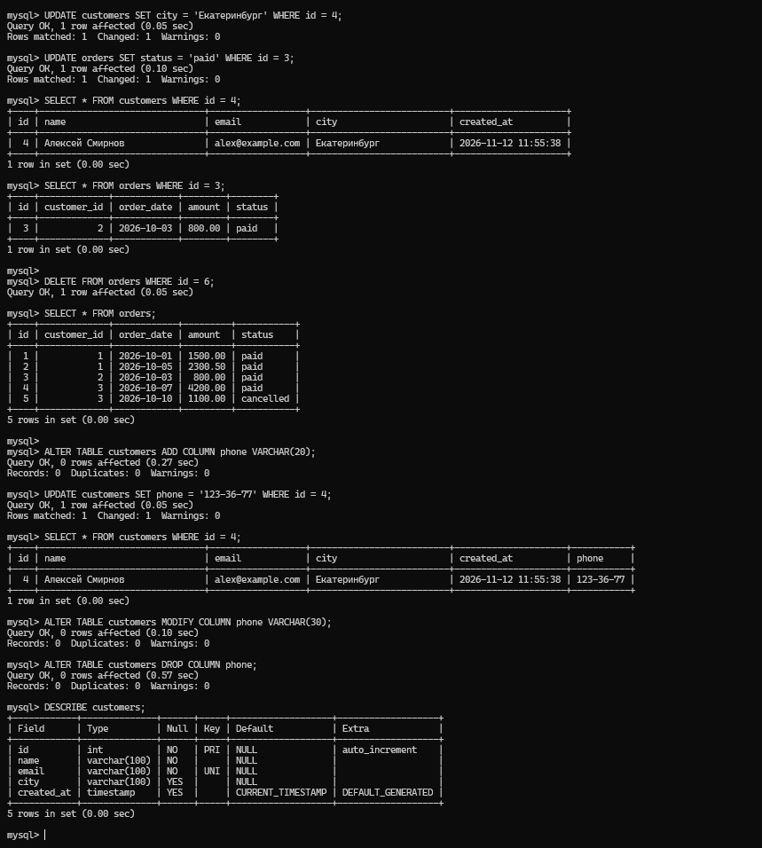

### 10. Экспорт журнала и резервной копии

Посмотреть историю действий через VIEW, в том числе отдельно запросы, связанные с таблицами. Экспортировать представление в файл на хосте и создать дамп базы.

```sql
SELECT * FROM my_actions ORDER BY event_time DESC;
SELECT * FROM my_actions
WHERE argument LIKE '%customers%'
ORDER BY event_time DESC
LIMIT 10;
```

Выйти из MySQL (`\q`), затем выполнить в WSL из `~/my-mysql`:

```bash
docker exec -e MYSQL_PWD=123 my-mysql mysql -uroot \
  --default-character-set=utf8mb4 \
  -e "SELECT * FROM sql_practice.my_actions ORDER BY event_time DESC" \
  > my_actions_export.log

docker exec -e MYSQL_PWD=123 my-mysql mysqldump -uroot \
  --set-gtid-purged=OFF \
  --single-transaction \
  sql_practice > dump_clean.sql

ls -lh my_actions_export.log dump_clean.sql
head -n 30 dump_clean.sql

# Скопировать оба результата в папку этого задания в Windows-репозитории
cp my_actions_export.log dump_clean.sql \
  /mnt/c/Users/user/ovsyanka/myNotes/databases/mysql-2/
```

В логе должны быть действия пользователя, отобранные VIEW; дамп должен содержать структуру и данные, без `SET @@GLOBAL.GTID_PURGED`.

**Проверка фильтра шага 10:** после перехода в `sql_practice` и пересоздания VIEW в результатах остались команды работы с базой и таблицами; служебные запросы больше не попадают в выборку.

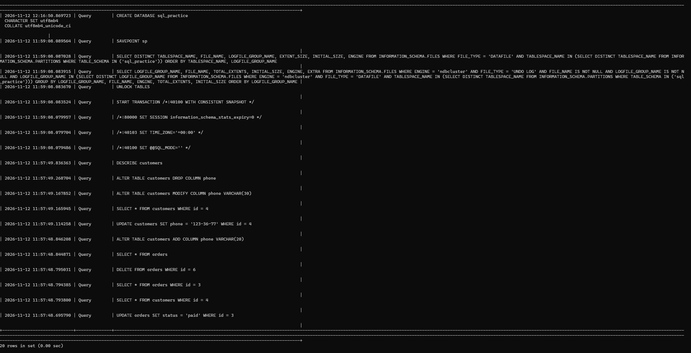

После исправления VIEW из WSL Bash повторно экспортированы `my_actions_export.log` и `dump_clean.sql`; оба файла скопированы в папку задания. Проверка в WSL не нашла в журнале `information_schema`, `SAVEPOINT`, `select @@` или `show tables`. В логе 56 строк, дамп содержит таблицы, данные и представление `my_actions`.

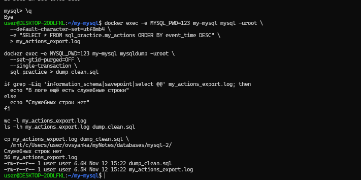

### 11. Удаление и восстановление базы

По заданию удалить таблицы и базу, а затем восстановить её из сохранённого дампа. Удаление выполняется только для учебной базы `sql_practice`; контейнер и его volume не удаляются. Команды `DROP` выполняются в клиенте при приглашении `mysql>`.

В MySQL:

```sql
DROP TABLE orders;
SHOW TABLES;
DROP TABLE customers;
SHOW TABLES;
DROP DATABASE sql_practice;
SHOW DATABASES;
```

Когда `SHOW DATABASES` подтвердит, что `sql_practice` больше нет, сделай снимок перед восстановлением.

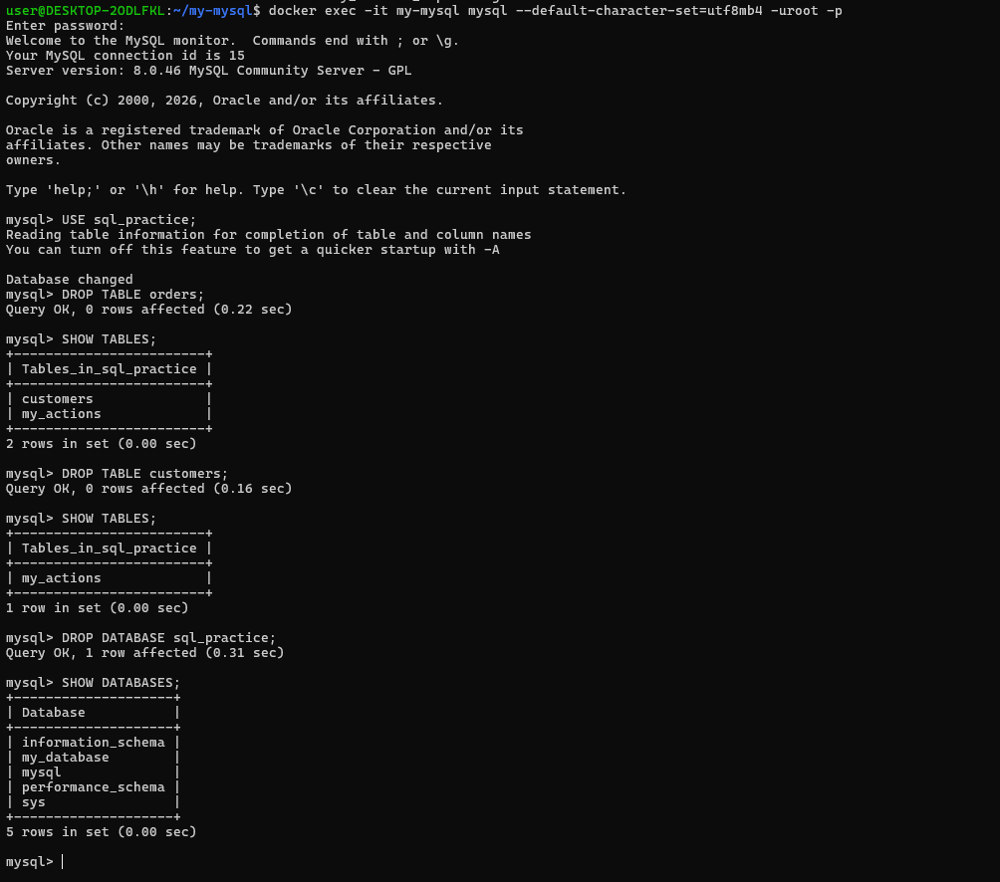

После последнего `DROP DATABASE` выйти из клиента командой `\q`. Теперь приглашение `$`, поэтому следующие команды выполняются в WSL Bash. Убедиться, что дамп существует:

```bash
ls -lh dump_clean.sql
head -n 30 dump_clean.sql
```

Подключиться к MySQL из WSL Bash:

```bash
docker exec -it my-mysql mysql --default-character-set=utf8mb4 -uroot -p
```

После ввода пароля и появления `mysql>` создать пустую базу:

```sql
CREATE DATABASE sql_practice
  CHARACTER SET utf8mb4
  COLLATE utf8mb4_unicode_ci;
```

Выйти из клиента через `\q`, вернуться в WSL Bash и импортировать дамп:

```bash
docker exec -i -e MYSQL_PWD=123 my-mysql \
  mysql --default-character-set=utf8mb4 -uroot sql_practice \
  < dump_clean.sql
```

Подключиться снова из WSL Bash и проверить, что восстановились таблицы, VIEW и данные:

```bash
docker exec -it my-mysql mysql --default-character-set=utf8mb4 -uroot -p
```

После ввода пароля выполнять проверки в MySQL-клиенте:

```sql
USE sql_practice;
SHOW TABLES;
SHOW FULL TABLES WHERE Table_type = 'VIEW';
SELECT * FROM customers;
SELECT * FROM orders;
SELECT * FROM my_actions LIMIT 5;
```

**Результат восстановления:** после импорта дампа вернулись таблицы `customers` и `orders`, представление `my_actions` и записи. Запросы выше подтверждают состав базы и данные.

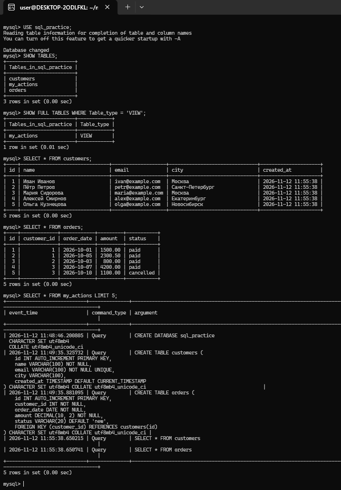

## Файлы для сдачи

По завершении положить рядом с этим README:

- `dump_clean.sql` — резервную копию `sql_practice`;
- `my_actions_export.log` — выгрузку пользовательских SQL-действий из VIEW;
- скриншоты шагов в `images/`.

| Результат | Состояние |
| --- | --- |
| [`dump_clean.sql`](dump_clean.sql) | Готовый дамп `sql_practice`, включая данные и VIEW `my_actions` (около 6,6 КБ). |
| [`my_actions_export.log`](my_actions_export.log) | 56 строк действий пользователя; проверка на служебные запросы пройдена (около 6,6 КБ). |
| Скриншоты | Добавлены подтверждения шагов 1–11, включая проверку восстановления. |

## Итог

В ходе работы настроен общий журнал MySQL и создано представление для отбора пользовательских SQL-запросов. В базе `sql_practice` созданы таблицы `customers` и `orders`, заполнены тестовыми данными и проверены фильтры, агрегатные функции, группировки, соединения, подзапросы, объединение результатов и операции изменения схемы и данных. Журнал действий и SQL-дамп сохранены отдельными файлами. После удаления учебная база была создана заново и успешно восстановлена из дампа; проверены таблицы, VIEW и записи.

