# Практическая работа: представления (VIEW) в MySQL

**Задание:** [VIEW в MySQL](https://github.com/rurewa/imfua/blob/main/content/Courses/Basics_database_design/content/bd/VIEW_MySQL.md)  
**Среда:** WSL 2, Docker Desktop, MySQL 8.0.  
**Контейнер:** `view-mysql`; **база:** `sql_practice`.

В этой работе я изучил представления MySQL: создал VIEW с фильтром по городу, сводный VIEW с `JOIN` и агрегатами, проверил обновление данных через представление, `WITH CHECK OPTION` и права отдельного пользователя. В конце сохранил дамп базы и журнал SQL-команд.

Для этой работы создан отдельный контейнер и отдельный Docker volume. Благодаря этому данные предыдущих упражнений и контейнер `my-mysql` не затрагиваются.

## Файлы задания

- `dump.sql` — дамп `sql_practice`, включая определения VIEW.
- `my_actions.log` — 56 строк журнала с командами, выполненными в ходе упражнения.
- `my.cnf` — конфигурация кодировки и файлового general log.
- `screenshots/` — скриншоты шагов выполнения.

## 1. Контейнер и конфигурация журнала

В WSL создан контейнер `view-mysql` с отдельным постоянным томом. Конфигурация MySQL задаёт `utf8mb4`, включает general log и записывает его в `/var/lib/mysql/general.log`.

```ini
[mysqld]
character-set-server = utf8mb4
collation-server = utf8mb4_unicode_ci
general_log = 1
general_log_file = /var/lib/mysql/general.log
log_output = FILE

[client]
default-character-set = utf8mb4

[mysql]
default-character-set = utf8mb4
```

Файл конфигурации был скопирован внутрь контейнера, после чего MySQL перезапущен. Запросы `SHOW VARIABLES` подтвердили `general_log = ON` и `log_output = FILE`.

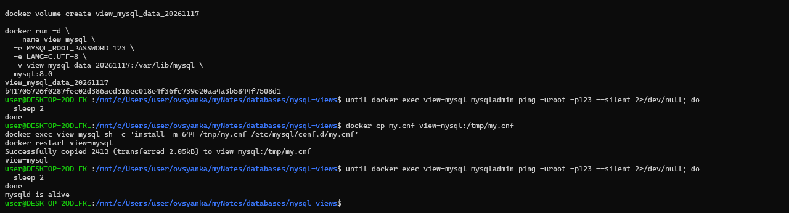

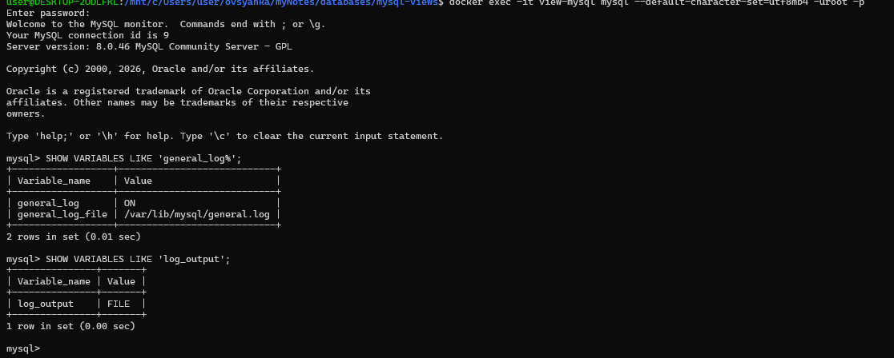

## 2. База данных и исходные таблицы

Создана база `sql_practice` с кодировкой `utf8mb4`. В ней созданы таблицы:

- `customers` — клиенты, адрес электронной почты, город и время создания;
- `orders` — заказы, сумма, дата, статус и внешний ключ на клиента.

В таблицы добавлены пять клиентов и шесть заказов. Результаты `SHOW TABLES` и `SELECT` подтвердили наличие таблиц и исходных данных.

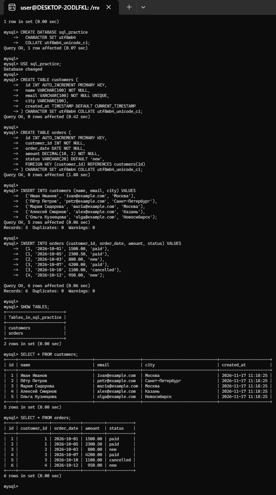

## 3. VIEW с фильтром по городу

Представление `moscow_customers` выбирает клиентов из Москвы и показывает только `id`, `name` и `email`.

```sql
CREATE OR REPLACE VIEW moscow_customers AS
SELECT id, name, email
FROM customers
WHERE city = 'Москва';

SELECT * FROM moscow_customers;
```

В результате отображаются Иван Иванов и Мария Сидорова. Затем в `customers` временно добавлен тестовый клиент из Москвы. Он сразу появился в VIEW; после проверки тестовая строка удалена.

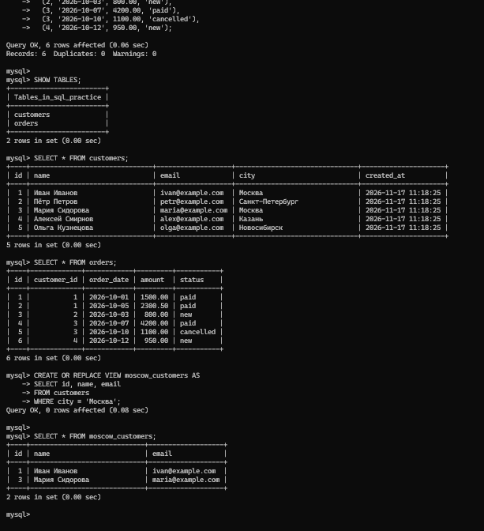

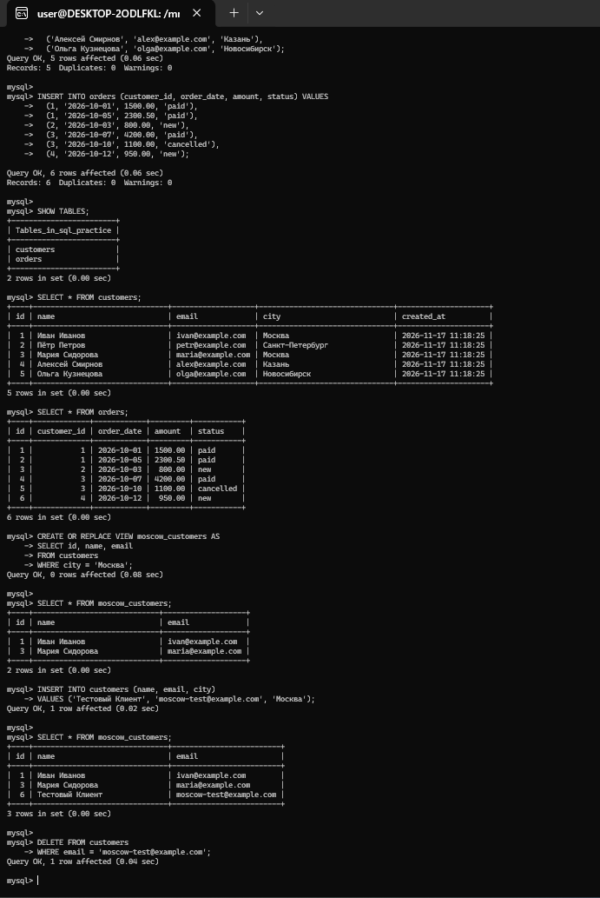

## 4. Сводное представление с JOIN и агрегатами

`customer_summary` объединяет клиентов и заказы через `LEFT JOIN`, считает число заказов и сумму покупок. `COALESCE` возвращает `0`, если у клиента нет заказов.

```sql
CREATE OR REPLACE VIEW customer_summary AS
SELECT c.id,
       c.name,
       c.city,
       COUNT(o.id) AS order_count,
       COALESCE(SUM(o.amount), 0) AS total_amount
FROM customers c
LEFT JOIN orders o ON c.id = o.customer_id
GROUP BY c.id, c.name, c.city;

SELECT * FROM customer_summary ORDER BY total_amount DESC;
```

По исходным данным сводка показывает для Марии Сидоровой `5300.00`, для Ивана Иванова `3800.50`, а для Ольги Кузнецовой без заказов — `0.00`. Дополнительными запросами проверены фильтрация по сумме и городу.

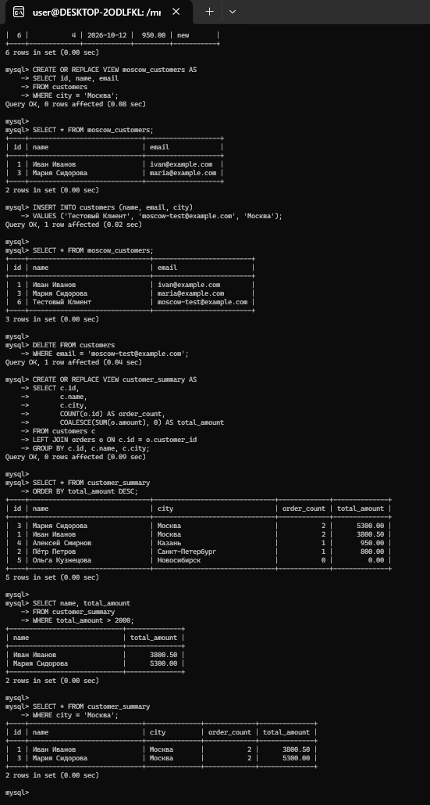

Список представлений проверен через `SHOW FULL TABLES WHERE Table_type = 'VIEW'`. Команда `SHOW CREATE VIEW customer_summary\G` показала сохранённое определение запроса.

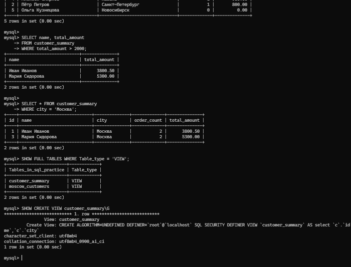

## 5. Изменение и удаление представления

`moscow_customers` заменено с помощью `CREATE OR REPLACE VIEW`: к выводу добавлен столбец `created_at`. Затем представление удалено командами `DROP VIEW` и `DROP VIEW IF EXISTS`. Последняя команда безопасно отрабатывает, даже когда VIEW уже удалено.

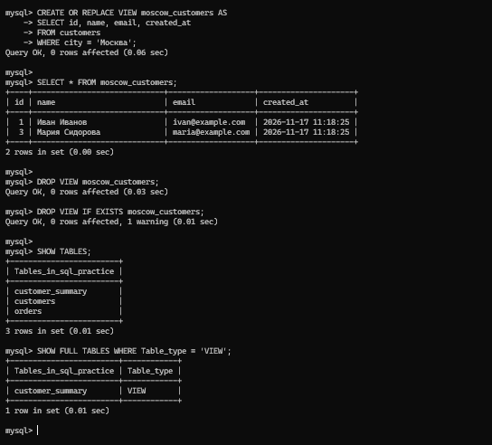

## 6. Обновляемое и необновляемое VIEW

Создано представление `active_customers`, выбирающее клиентов, у которых указан город. Через него город Петра временно изменён на Сочи, затем исходное значение восстановлено. Через то же VIEW добавлена и удалена тестовая строка.

Попытка изменить имя через `customer_summary` завершилась ожидаемой ошибкой `The target table customer_summary of the UPDATE is not updatable`: представление содержит агрегаты и группировку, поэтому MySQL не может однозначно определить строку для изменения.

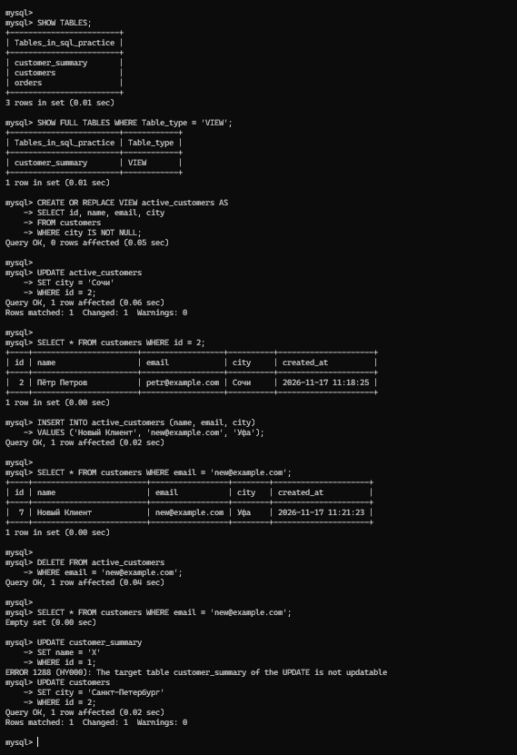

Для запроса к сводному VIEW выполнен `EXPLAIN`. План показывает, как MySQL обрабатывает запрос с условием по городу.

```sql
EXPLAIN
SELECT * FROM customer_summary
WHERE city = 'Москва';
```

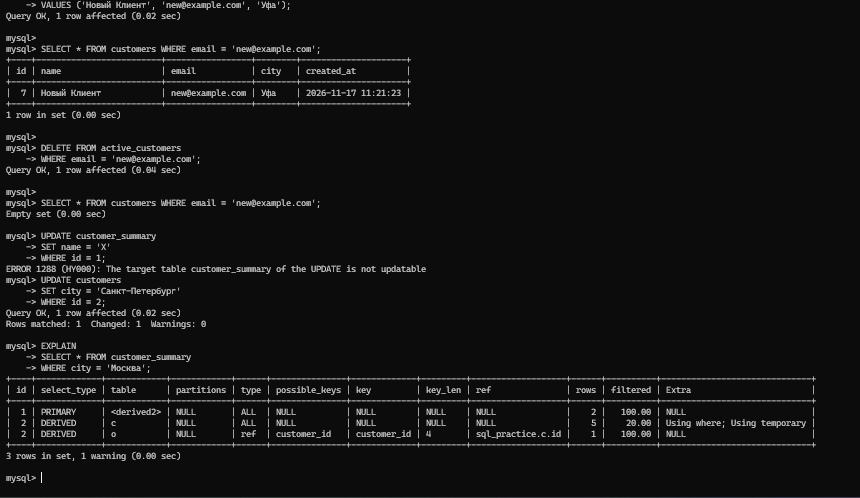

## 7. Проверка WITH CHECK OPTION

Сначала `moscow_customers` было создано без `WITH CHECK OPTION`. Через него вставлен клиент из Казани: запись появилась в базовой таблице, но не отображалась в представлении.

После пересоздания VIEW с `WITH CHECK OPTION` аналогичная вставка была отклонена с ожидаемой ошибкой `CHECK OPTION failed`. Тестовые записи удалены; в `customers` остались исходные пять клиентов.

```sql
CREATE OR REPLACE VIEW moscow_customers AS
SELECT id, name, email, city
FROM customers
WHERE city = 'Москва'
WITH CHECK OPTION;
```

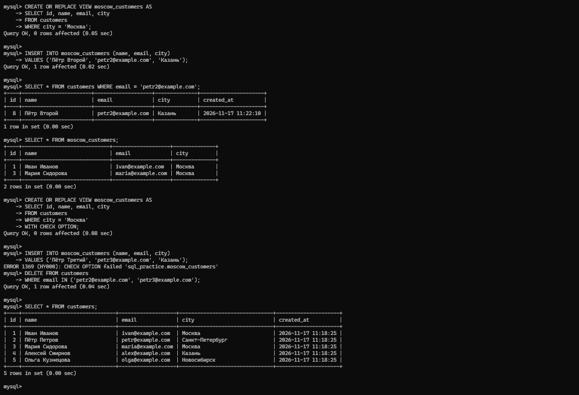

## 8. Права на представление

Создано `public_customers`, которое не содержит столбец `email`. Пользователю `analyst` выдано право `SELECT` только на это представление.

```sql
CREATE OR REPLACE VIEW public_customers AS
SELECT id, name, city FROM customers;

CREATE USER 'analyst'@'%' IDENTIFIED BY 'pass';
GRANT SELECT ON sql_practice.public_customers TO 'analyst'@'%';
```

Проверка подтвердила, что `analyst` может прочитать `public_customers`, но не имеет права читать таблицу `customers` напрямую.

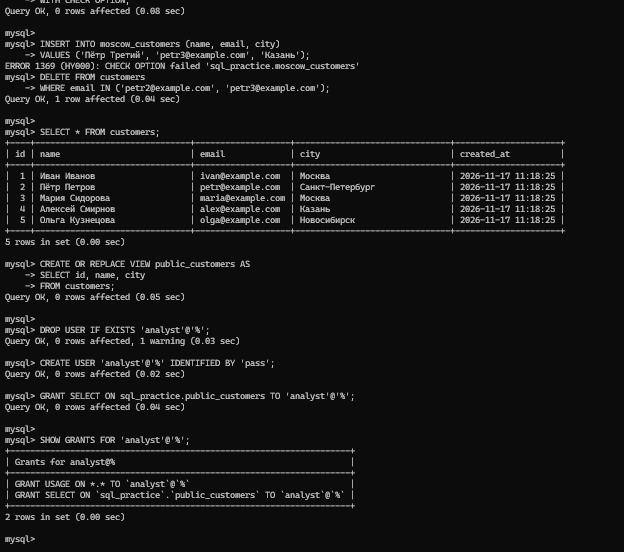

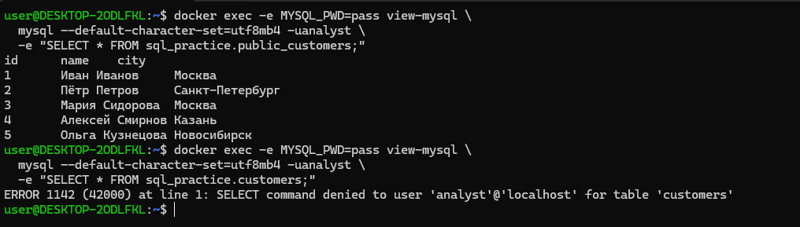

## 9. Журнал действий и дамп

Журнал MySQL проверен в `/var/lib/mysql/general.log`. После завершения SQL-шагов журналирование выключено, а строки с командами `Query` экспортированы в `my_actions.log`. Автоматическая строка `select @@version_comment limit 1` удалена из экспорта. В итоговом файле осталось **56 строк**.

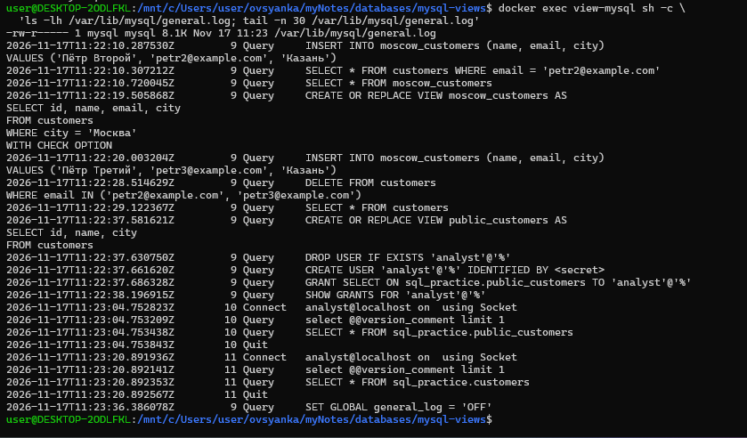

База экспортирована командой `mysqldump`. В дампе присутствуют таблицы и определения созданных представлений. Размер файлов и количество строк журнала проверены в WSL.

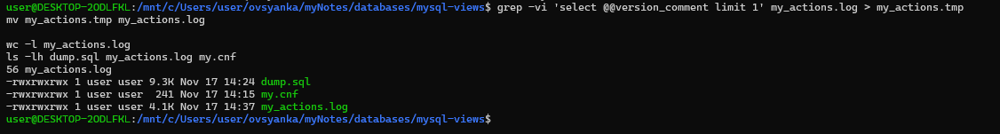

## Итог

В ходе работы созданы и проверены простое, агрегатное, обновляемое и ограниченное `WITH CHECK OPTION` представления. Также проверены план выполнения запроса и выдача прав на VIEW без доступа к исходной таблице. Дамп, конфигурация и журнал действий находятся рядом с этим README.
