# Лабораторная работа № 1: нормализация данных до 3NF

**Задание:** [Normalization_1.md — нормализация данных в БД с ведением лога](https://github.com/rurewa/imfua/blob/main/content/Courses/Basics_database_design/content/bd/Normalization_1.md)  
**Среда:** WSL 2, Docker Desktop, MySQL 8.0.  
**Контейнер:** `view-mysql`; **база:** `sales_norm`.

В лабораторной работе исследована таблица заказов с повторяющимися данными о покупателях, отчётах и товарах. На её примере показаны аномалии обновления, удаления и вставки. Затем данные разложены на четыре связанные таблицы третьей нормальной формы, сверены с исходными, сохранены дампы до и после преобразования и экспортирован журнал SQL-команд.

> **Примечание к тексту задания:** в списке целей исходная таблица названа `orders_bad`, а в подробном примере — `sales_unnormalized_2`; также в разных местах встречаются `sales_norm` и `normalization_task`. Здесь использованы имена из списка целей (`sales_norm`, `orders_bad`) и поля/данные из подробного SQL-примера.

Для этой лабораторной использована отдельная база `sales_norm` в уже работающем контейнере `view-mysql`. Данные предыдущих лабораторных не изменялись.

## Результат

После нормализации созданы таблицы:

| Таблица | Назначение |
|---|---|
| `customers` | Покупатели и их названия |
| `products` | Товары и цены |
| `reports` | Дата отчёта и покупатель |
| `report_items` | Товары и количество в отчёте; составной ключ `(report_id, product_id)` |

Исходная таблица после сверки переименована в `orders_bad_archive` и оставлена как архив. В результате проверок совпали число исходных строк, число уникальных сущностей и сумма продаж.

## 1. Настройка журнала MySQL

В отдельной рабочей папке был очищен файл журнала контейнера, затем включён файловый general log. Проверка переменных показала `general_log = ON` и `log_output = FILE`.

```sql
SET GLOBAL log_output = 'FILE';
SET GLOBAL general_log = 'ON';

SHOW VARIABLES LIKE 'general_log';
SHOW VARIABLES LIKE 'log_output';
```

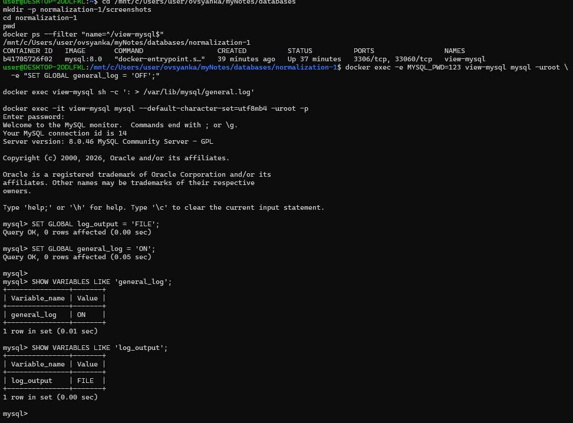

## 2. Исходная таблица и данные

Создана база `sales_norm` и таблица `orders_bad`. В таблицу помещены семь строк: один отчёт может содержать несколько товаров, поэтому данные отчёта и покупателя повторяются.

```sql
CREATE DATABASE sales_norm
  CHARACTER SET utf8mb4
  COLLATE utf8mb4_unicode_ci;
USE sales_norm;

CREATE TABLE orders_bad (
    report_id INT,
    report_date DATE,
    customer_id INT,
    customer_name VARCHAR(100),
    product_id INT,
    product_name VARCHAR(100),
    price DECIMAL(10,2),
    quantity INT
);

INSERT INTO orders_bad VALUES
(1101, '2026-03-05', 12, 'Дания',   101, 'Дыни',      800, 1100),
(1101, '2026-03-05', 12, 'Дания',   102, 'Клубника',  150,  300),
(1102, '2026-03-07', 23, 'Испания', 103, 'Яблоки',    120, 1700),
(1103, '2026-03-08', 25, 'Албания', 104, 'Лимоны',    200,  500),
(1104, '2026-03-10', 12, 'Дания',   101, 'Дыни',      800, 2500),
(1105, '2026-03-12', 25, 'Албания', 103, 'Яблоки',    120, 2000),
(1105, '2026-03-12', 25, 'Албания', 104, 'Лимоны',    200,  700);

SHOW TABLES;
SELECT * FROM orders_bad;
```

`SHOW TABLES` и `SELECT * FROM orders_bad` подтвердили наличие таблицы и семи исходных строк.

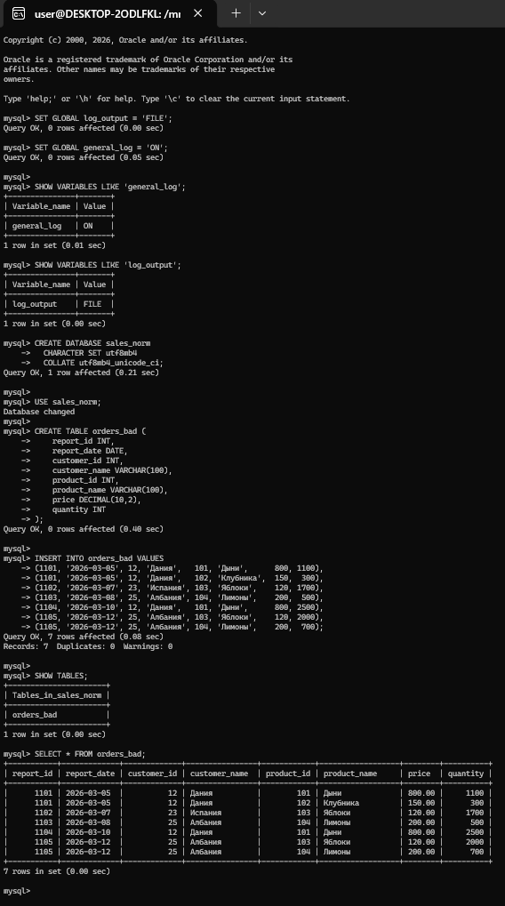

## 3. Аномалии в ненормализованной таблице

Каждая демонстрация выполнялась внутри транзакции и отменялась через `ROLLBACK`, поэтому исходные данные сохранились.

### Аномалия обновления

Название покупателя с кодом `12` встречается в трёх строках. Изменение названия лишь в одной строке временно оставило разные значения для одного и того же покупателя. `ROLLBACK` вернул исходные данные.

```sql
START TRANSACTION;
UPDATE orders_bad
SET customer_name = 'Датское королевство'
WHERE report_id = 1101 AND product_id = 101;

SELECT report_id, product_id, customer_id, customer_name
FROM orders_bad
WHERE customer_id = 12
ORDER BY report_id, product_id;

ROLLBACK;
```

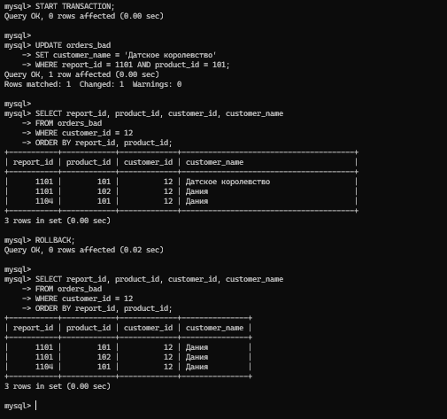

### Аномалия удаления

Покупатель `23` представлен только отчётом `1102`. Временное удаление строк этого отчёта удалило также единственную запись с именем покупателя. После проверки `ROLLBACK` восстановил отчёт.

```sql
START TRANSACTION;
DELETE FROM orders_bad WHERE report_id = 1102;
SELECT DISTINCT customer_id, customer_name
FROM orders_bad WHERE customer_id = 23;
ROLLBACK;
```

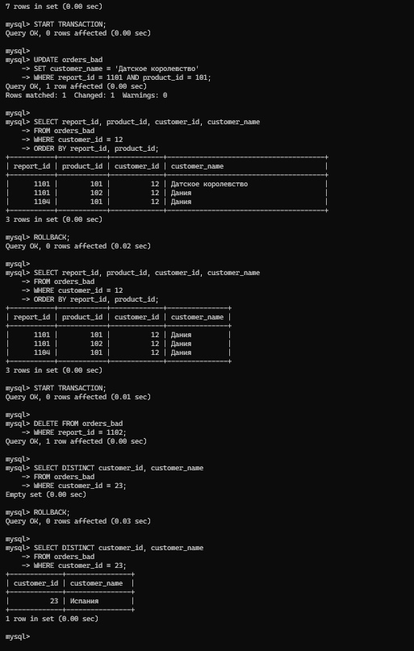

### Аномалия вставки

В таблицу можно добавить покупателя без отчёта, но тогда сведения о отчёте и товаре остаются `NULL`. Временная строка была отменена транзакцией; после этого в таблице снова семь исходных строк.

```sql
START TRANSACTION;
INSERT INTO orders_bad (customer_id, customer_name)
VALUES (99, 'Тестовый покупатель');
SELECT * FROM orders_bad WHERE customer_id = 99;
ROLLBACK;
SELECT COUNT(*) AS source_rows FROM orders_bad;
```

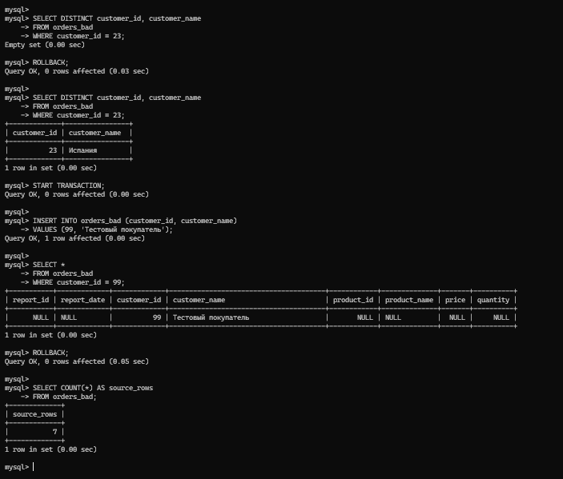

## 4. Дамп до нормализации

До создания новой схемы база сохранена в `dump_before.sql`. В дампе зафиксирована исходная таблица `orders_bad`.

```bash
docker exec -e MYSQL_PWD=123 view-mysql \
  mysqldump --default-character-set=utf8mb4 -uroot \
  --single-transaction sales_norm > dump_before.sql
```

[Открыть дамп до нормализации](dump_before.sql)

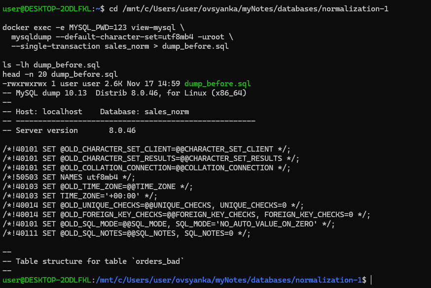

## 5. Разложение данных на таблицы 3NF

В каждой строке исходной таблицы хранится одна позиция товара с атомарными значениями — это соответствует 1NF. Для определения строки логически нужны `report_id` и `product_id`; исходная таблица не объявляла этот составной ключ ограничением. Данные покупателя и дата зависят только от `report_id`, а название и цена товара — только от `product_id`, то есть исходная структура нарушает 2NF. Кроме того, `customer_id → customer_name` и `product_id → product_name, price` — транзитивные зависимости, которые устраняются для 3NF разделением сущностей:

- `customers`: `customer_id → customer_name`;
- `products`: `product_id → product_name, price`;
- `reports`: `report_id → report_date, customer_id`;
- `report_items`: составной ключ `(report_id, product_id) → quantity`.

Таблицы связаны внешними ключами. В `report_items` добавлен составной первичный ключ, который не позволяет продублировать один и тот же товар в отчёте.

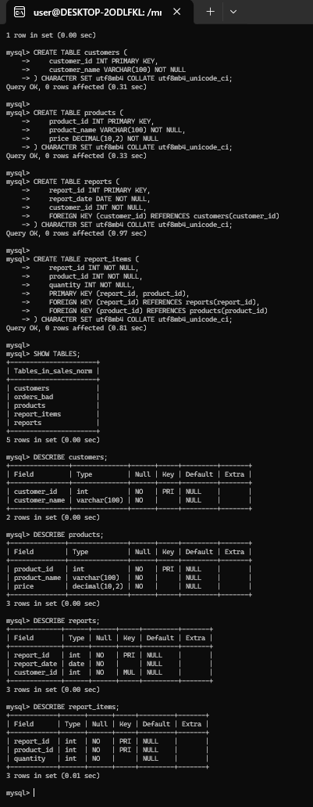

## 6. Перенос строк

Справочники и заголовки отчётов заполнены уникальными значениями через `SELECT DISTINCT`. Позиции отчётов перенесены из исходных строк.

```sql
INSERT INTO customers (customer_id, customer_name)
SELECT DISTINCT customer_id, customer_name FROM orders_bad;

INSERT INTO products (product_id, product_name, price)
SELECT DISTINCT product_id, product_name, price FROM orders_bad;

INSERT INTO reports (report_id, report_date, customer_id)
SELECT DISTINCT report_id, report_date, customer_id FROM orders_bad;

INSERT INTO report_items (report_id, product_id, quantity)
SELECT report_id, product_id, quantity FROM orders_bad;
```

Получено 3 покупателя, 4 товара, 5 отчётов и 7 позиций.

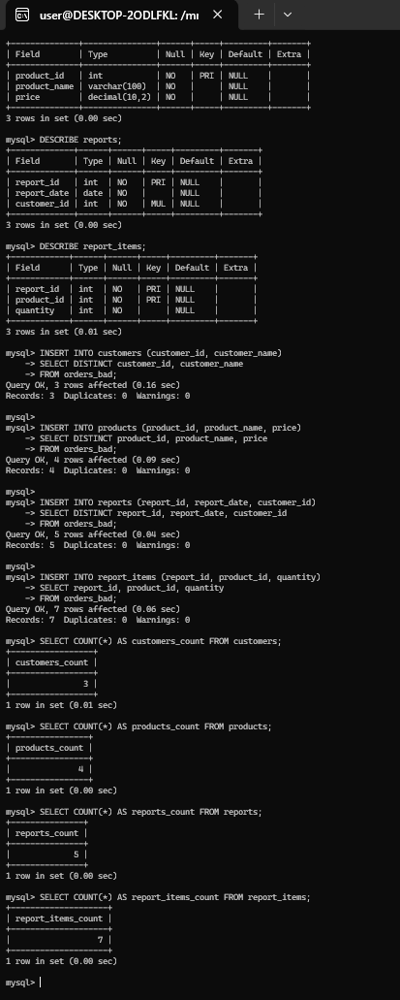

## 7. Сверка данных и контрольный запрос

Исходная таблица содержит 7 строк, 3 уникальных покупателя, 4 товара и 5 отчётов. Сумма `SUM(price * quantity)` до нормализации равна `3 609 000.00`; сумма по `products` и `report_items` совпала.

Контрольный запрос по покупателю с кодом `12` вернул `2 925 000.00`.

```sql
SELECT SUM(p.price * ri.quantity) AS normalized_total
FROM report_items ri
JOIN products p ON p.product_id = ri.product_id;

SELECT c.customer_id, c.customer_name,
       SUM(p.price * ri.quantity) AS total_spent
FROM customers c
JOIN reports r ON r.customer_id = c.customer_id
JOIN report_items ri ON ri.report_id = r.report_id
JOIN products p ON p.product_id = ri.product_id
WHERE c.customer_id = 12
GROUP BY c.customer_id, c.customer_name;
```

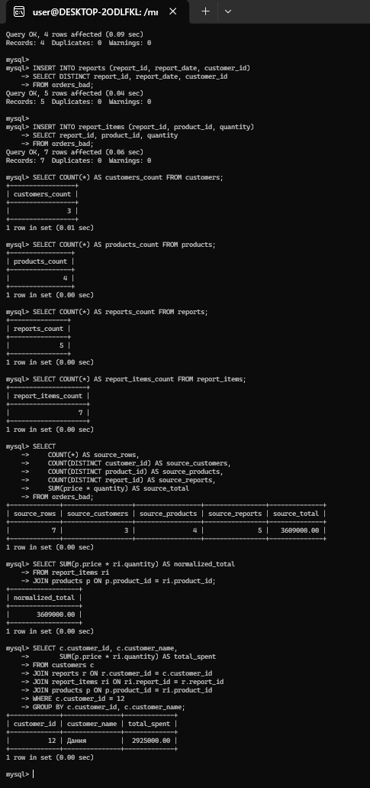

## 8. Архивирование исходной таблицы

После успешной сверки `orders_bad` переименована в `orders_bad_archive`. Исходные семь строк сохранены, а таблицы нормализованной схемы остаются рядом.

```sql
RENAME TABLE orders_bad TO orders_bad_archive;
SHOW TABLES;
SELECT COUNT(*) AS archived_source_rows FROM orders_bad_archive;
```

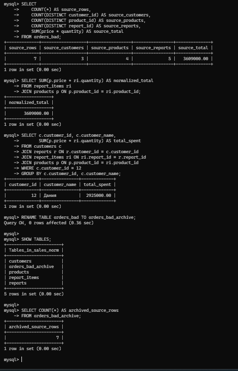

## 9. Дамп после нормализации и журнал действий

После преобразования создан `dump_after.sql`. В нём присутствуют четыре нормализованные таблицы и архив `orders_bad_archive`. Файловый general log экспортирован в `my_actions.log`; внутренний запрос клиента `select @@version_comment limit 1` удалён. В журнале — 80 строк.

```bash
docker exec -e MYSQL_PWD=123 view-mysql \
  mysqldump --default-character-set=utf8mb4 -uroot \
  --single-transaction sales_norm > dump_after.sql

docker exec view-mysql sh -c \
  "grep -E '[[:space:]]Query[[:space:]]' /var/lib/mysql/general.log" \
  | grep -vi 'select @@version_comment limit 1' > my_actions.log
```

- [Дамп до нормализации](dump_before.sql)
- [Дамп после нормализации](dump_after.sql)
- [Журнал SQL-команд](my_actions.log)

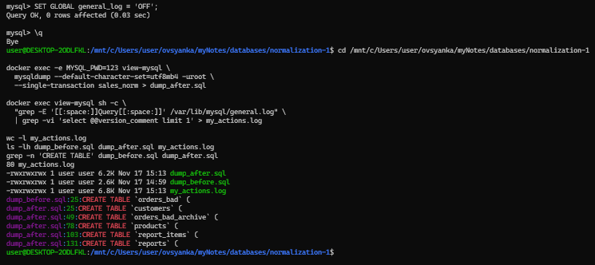

## Итог

Ненормализованная таблица создаёт избыточность и аномалии: обновление одного факта требует согласованно менять несколько строк; удаление отчёта может стереть сведения о покупателе; новая сущность не помещается в таблицу без неотносящихся к ней данных. Разделение на `customers`, `products`, `reports` и `report_items` устранило эти зависимости. Сверка подтвердила сохранность семи позиций и общей суммы продаж.
