# Задание 3. MySQL: основные SQL-операции над двумя таблицами товаров

**Задание:** [Основные SQL-операции на примере двух таблиц products1 и products2](https://github.com/rurewa/imfua/blob/main/content/Courses/Basics_database_design/content/bd/Products.md)  
**Окружение:** WSL 2, Docker Desktop, MySQL 8.0.46.  
**Рабочая папка:** myNotes/databases/products/

В работе создана база shop с таблицами products1 и products2. На их данных проверены фильтрация и проекция, UNION, EXCEPT, INTERSECT, декартово произведение и JOIN. В конце база удалена и восстановлена из SQL-дампа.

## Материалы задания

- [dump.sql](dump.sql) — структура и данные обеих таблиц.
- [my_actions.log](my_actions.log) — отфильтрованные запросы для базы и таблиц задания.
- [my.cnf](my.cnf) — конфигурационный файл с кодировкой и настройками журнала.
- [Скриншоты выполнения](images/).

## 1. Подготовка каталога и запуск контейнера

Задание выполнялось в WSL из каталога репозитория. Для MySQL создан отдельный контейнер products-mysql и volume products_mysql_data, чтобы не затрагивать контейнеры и данные предыдущих практических работ. Для правильного отображения русских названий создан файл my.cnf.

Файл конфигурации и запуск контейнера:

    docker run --name products-mysql \
      -e MYSQL_ROOT_PASSWORD=123 \
      -e LANG=C.UTF-8 \
      -v products_mysql_data:/var/lib/mysql \
      -v "$(pwd)/my.cnf":/etc/mysql/conf.d/my.cnf \
      -d mysql:8.0

После запуска контейнер проверен командой docker ps.

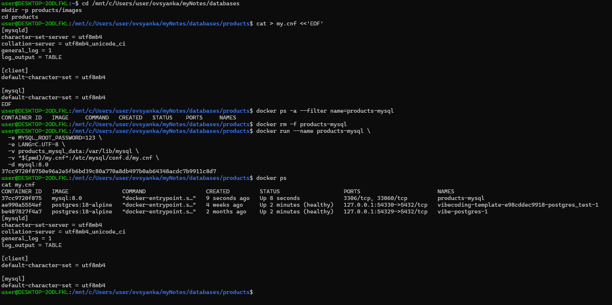

## 2. Создание базы данных

Подключение к контейнеру из WSL и проверка версии MySQL:

    docker exec -it products-mysql mysql --default-character-set=utf8mb4 -uroot -p

В MySQL-клиенте введён пароль 123 и выполнены команды:

    SELECT VERSION();

    CREATE DATABASE shop
      CHARACTER SET utf8mb4
      COLLATE utf8mb4_unicode_ci;

    USE shop;
    SHOW DATABASES;

Использовался MySQL 8.0.46, поэтому доступны EXCEPT и INTERSECT, требующие MySQL 8.0.31 или новее.

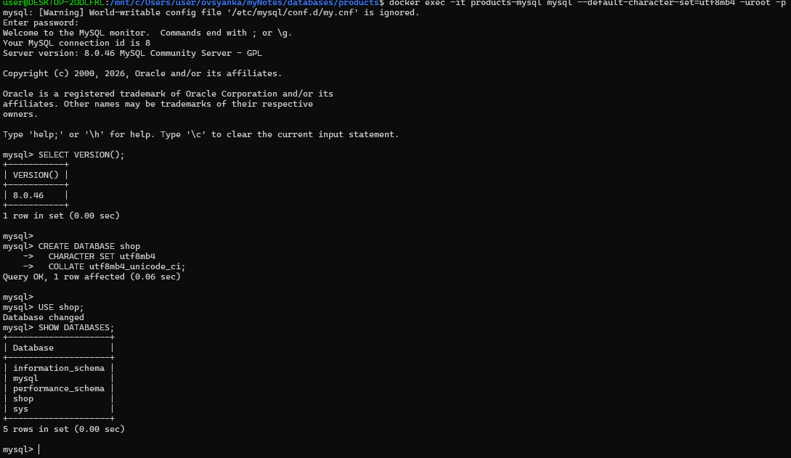

## 3. Создание таблиц

В базе shop созданы две таблицы с названиями товаров и их ценами. После создания проверены список таблиц и структура каждой таблицы.

    CREATE TABLE products1 (
        name  VARCHAR(100) NOT NULL,
        price INT NOT NULL
    ) CHARACTER SET utf8mb4 COLLATE utf8mb4_unicode_ci;

    CREATE TABLE products2 (
        name  VARCHAR(100) NOT NULL,
        price INT NOT NULL
    ) CHARACTER SET utf8mb4 COLLATE utf8mb4_unicode_ci;

    SHOW TABLES;
    DESCRIBE products1;
    DESCRIBE products2;

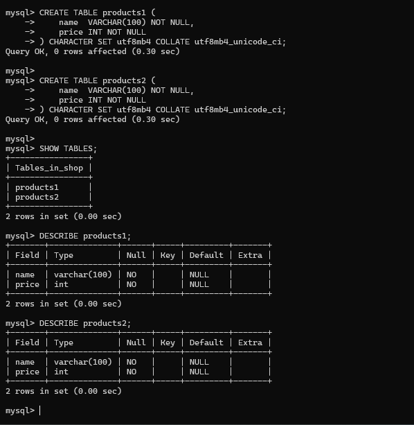

## 4. Заполнение таблиц тестовыми данными

В обе таблицы добавлены товары из задания. Выборкой SELECT проверено, что каждая таблица содержит четыре строки.

    INSERT INTO products1 (name, price) VALUES
      ('Дыни', 800),
      ('Клубника', 150),
      ('Яблоки', 120),
      ('Лимоны', 200);

    INSERT INTO products2 (name, price) VALUES
      ('Дыни', 800),
      ('Клубника', 150),
      ('Каштаны', 200),
      ('Хурма', 350);

    SELECT * FROM products1;
    SELECT * FROM products2;

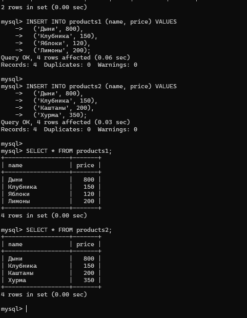

## 5. Выборка, проекция и UNION

Сначала выполнена фильтрация товаров первой таблицы по цене выше 150. Затем выбраны только названия товаров. Оператор UNION объединил названия двух таблиц и убрал повторы.

    SELECT * FROM products1 WHERE price > 150;

    SELECT name FROM products1;

    SELECT name FROM products1
    UNION
    SELECT name FROM products2;

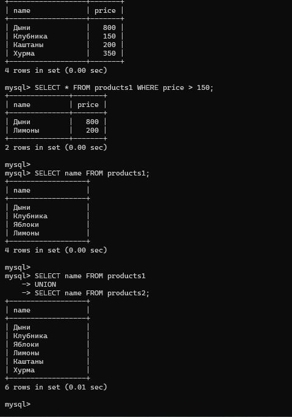

## 6. Разность и пересечение множеств

EXCEPT показал товары, которые есть в products1, но отсутствуют в products2. INTERSECT вернул общие товары с той же ценой.

    SELECT name, price FROM products1
    EXCEPT
    SELECT name, price FROM products2;

    SELECT name, price FROM products1
    INTERSECT
    SELECT name, price FROM products2;

В результате EXCEPT вернул Яблоки и Лимоны, а INTERSECT — Дыни и Клубника.

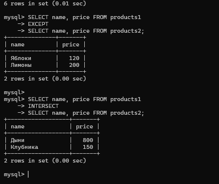

## 7. Декартово произведение

CROSS JOIN сформировал каждую возможную пару товаров из двух таблиц. Поскольку в каждой таблице по четыре строки, результат содержит 16 строк.

    SELECT t1.name AS name1, t1.price AS price1,
           t2.name AS name2, t2.price AS price2
    FROM products1 t1
    CROSS JOIN products2 t2;

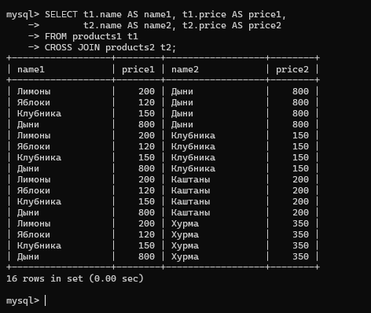

## 8. Соединение JOIN

INNER JOIN оставил совпадающие названия товаров. LEFT JOIN сохранил все строки products1, а для товаров без пары во второй таблице показал NULL.

    SELECT t1.name, t1.price AS price1, t2.price AS price2
    FROM products1 t1
    JOIN products2 t2 ON t1.name = t2.name;

    SELECT t1.name, t1.price AS price1, t2.price AS price2
    FROM products1 t1
    LEFT JOIN products2 t2 ON t1.name = t2.name;

Операция деления в задании приведена как теоретическое пояснение: для двух таблиц списков товаров она не выполнялась.

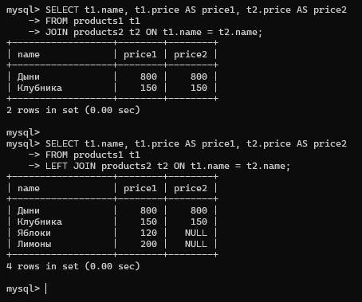

## 9. Создание и проверка дампа

Из MySQL-клиента выполнен выход командой \q. В WSL Bash создан дамп базы shop:

    docker exec -e MYSQL_PWD=123 products-mysql \
      mysqldump --default-character-set=utf8mb4 \
      --single-transaction -uroot shop > dump.sql

Проверены размер и начало файла. Дополнительно grep подтвердил, что дамп содержит CREATE TABLE и INSERT для обеих таблиц.

    ls -lh dump.sql
    head -n 30 dump.sql
    grep -nE 'CREATE TABLE|INSERT INTO' dump.sql

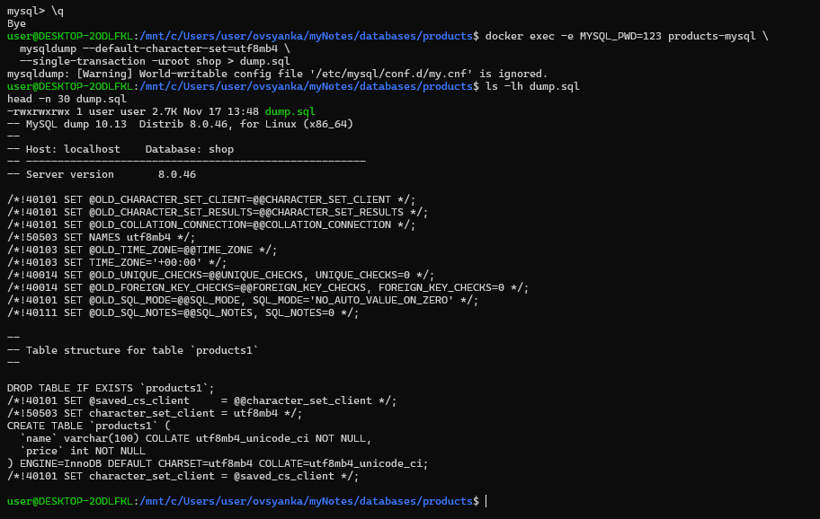

## 10. Удаление базы

Перед удалением проверены база и таблицы. Затем в MySQL-клиенте удалена только учебная база shop и проверен список оставшихся баз.

    SHOW DATABASES;
    USE shop;
    SHOW TABLES;
    DROP DATABASE shop;
    SHOW DATABASES;

Контейнер и volume products_mysql_data оставлены на месте.

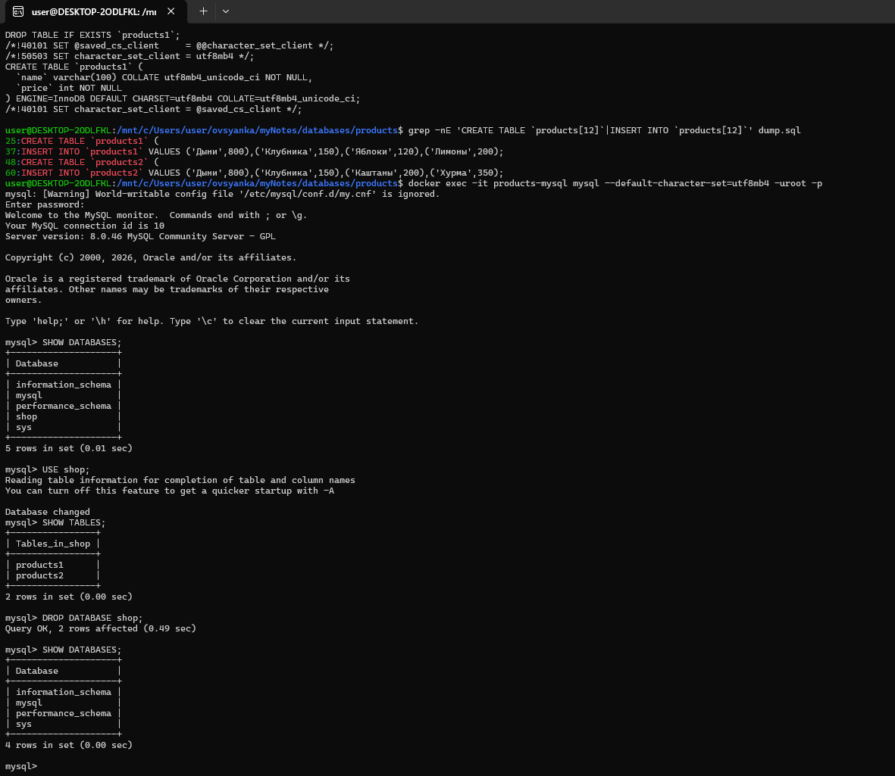

## 11. Восстановление базы

После удаления создана пустая база shop. Дамп импортирован из WSL Bash:

    docker exec -i -e MYSQL_PWD=123 products-mysql \
      mysql --default-character-set=utf8mb4 -uroot shop < dump.sql

После импорта проверены список таблиц и данные:

    USE shop;
    SHOW TABLES;
    SELECT * FROM products1;
    SELECT * FROM products2;

Восстановились обе таблицы и исходные четыре товара в каждой.

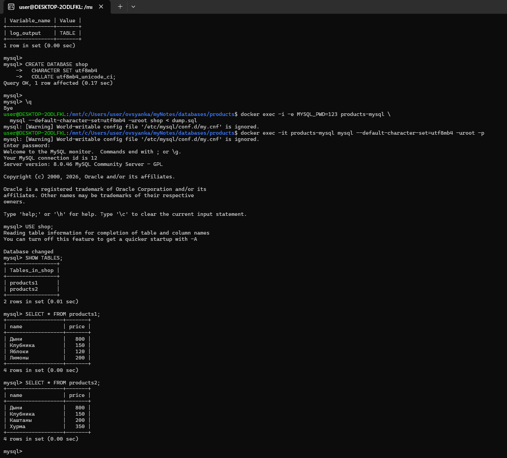

## 12. Проверка журнала SQL-запросов

При первом запуске MySQL выдал предупреждение, что файл my.cnf с Windows-пути доступен на запись всем пользователям, поэтому он был проигнорирован. Для этой работы кодировка базы и таблиц была задана непосредственно при создании объектов. После удаления базы журнал включён командами MySQL:

    SET GLOBAL log_output = 'TABLE';
    SET GLOBAL general_log = ON;

Параметры проверены через SHOW VARIABLES. После восстановления повторно выполнены запросы из разделов 5–8, чтобы они попали в журнал.

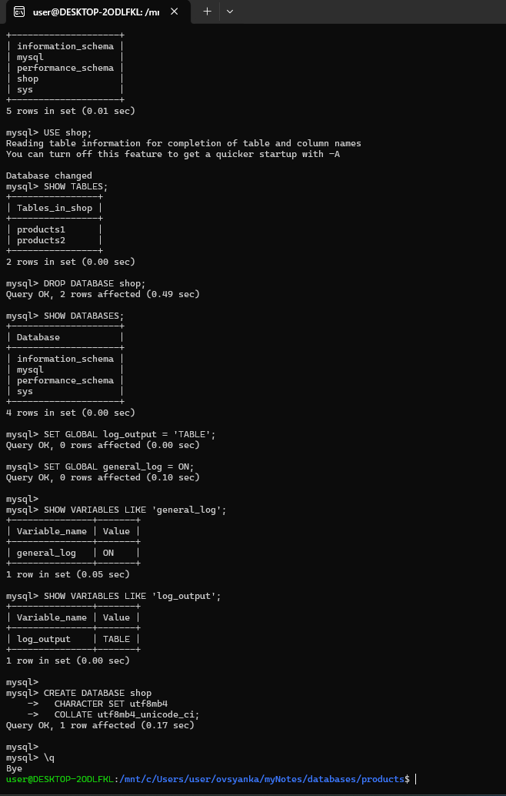

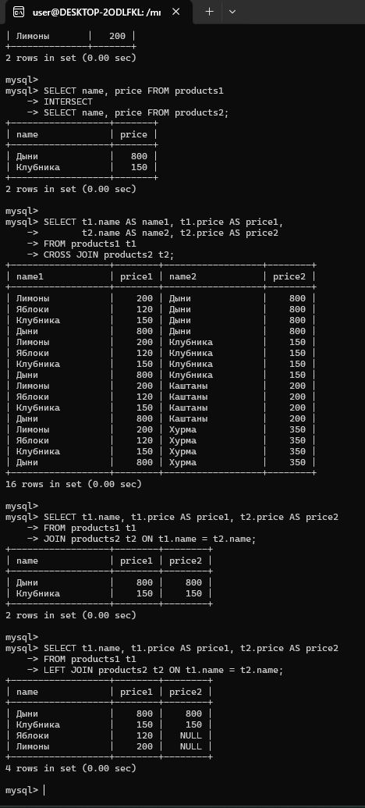

Из mysql.general_log выгружены записи root-соединения, относящиеся к shop, products1 и products2. Команда экспорта выполнена из WSL Bash, результат сохранён в my_actions.log.

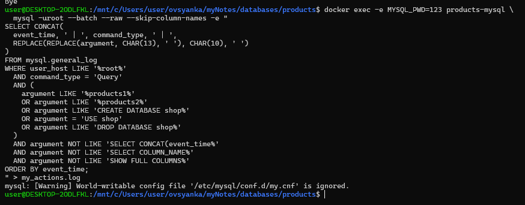

## Результат

Работа завершена: созданы и заполнены две таблицы; проверены основные операции SQL над наборами данных; база shop удалена и восстановлена из дампа. В папке задания сохранены отдельный README, дамп, лог и скриншоты. Перед сдачей приложены оба файла — dump.sql и my_actions.log.

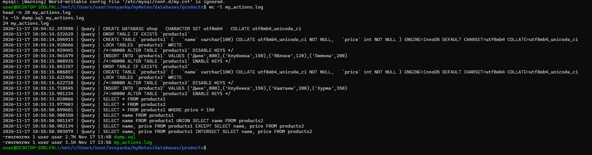
